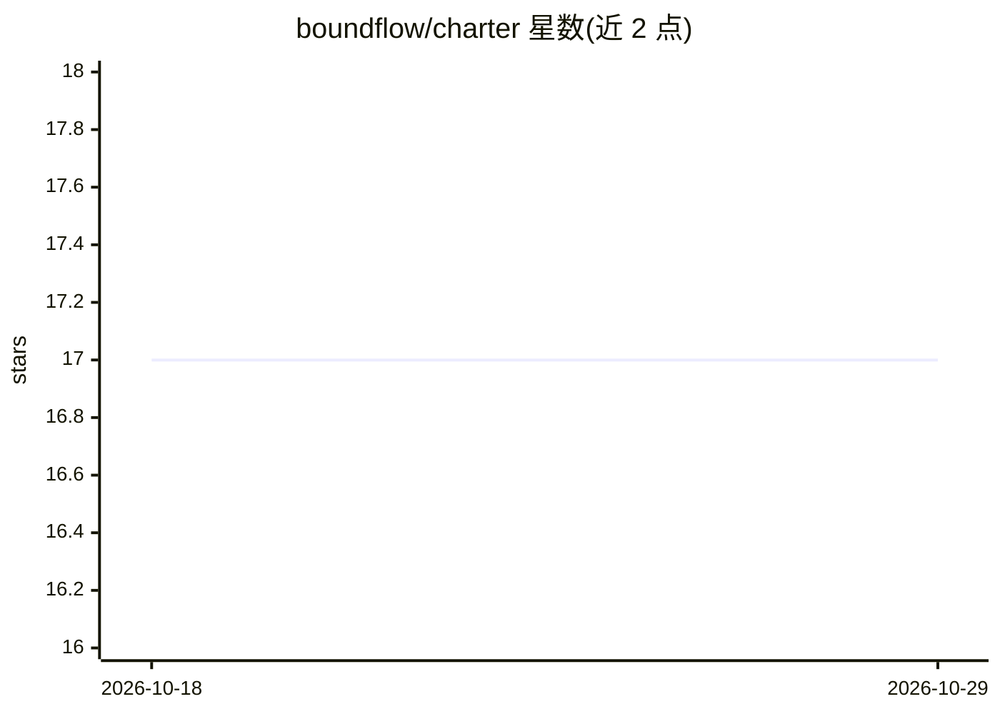

# boundflow/charter

⭐ 17 · Python · Apache-2.0 · 推送 2026-09-16 · [GitHub](https://github.com/boundflow/charter) · 组织维护

**自托管环境下运行与治理 AI agent 的开源平台**

Charter 是一个在生产环境运行 AI agent 的开源平台：以 YAML 定义 agent 与策略，由持久化控制平面治理，worker 在用户自己的环境中运行。核心机制包括持久执行（运行可暂停等待人工审批、跨 worker 数日后恢复）、基于阈值的生命周期策略（暂停/冷却/回滚）、工具门控与预算限制、审计记录及 OpenTelemetry GenAI 追踪导出。agent 循环基于 deepagents 构建，推理自带模型（支持本地 Ollama）。目前 pre-1.0，配置格式与 CLI 可能随版本变动。以 pip 包和 docker compose 部署的控制平面提供。

## 筛选速览

| 维度 | 判定 | 备注 |
|---|---|---|
| AI 角色 | `ai-ecosystem` | LLM/agent 周边工具 |
| 许可风险 | `permissive` | Apache-2.0 |
| 部署形态 | `self-host` | docker 或自建部署 |
| 模型依赖 | local-ok | 支持本地模型 |
| 硬件要求 | — | 无带数字的原话,不猜 |
| 安装摩擦 | `low` | 无编译、无系统依赖或容器化 |
| 成熟度 | `idea` | |

## 能力要点

- 持久执行：运行可停在人工审批门，数天后在其他 worker 恢复
- 策略驱动治理：指标过阈值时暂停/冷却/回滚 agent 版本
- 工具门控与人工审批，审批与拒绝均记录行为人与理由
- 模型密钥与提示词不经过控制平面，可完全离线运行

## 适用场景

- 在生产环境运行需要人工审批关键动作的 AI agent
- 对 agent 施加预算、工具范围与生命周期策略治理
- 在自有网络中运行 agent 使其直接访问内部服务与数据库

## 场景标签

`Agent 框架` `LLM 可观测性` · 领域:Agent 开发

## 证据(README 行号)

> L7: Charter is an open-source platform for running AI agents in production. You define
> L8: an agent and its policies in YAML. Charter runs it on your compute and governs it
> L214: The agent loop itself is deepagents,

## 星数曲线

2026-10-18 17 → 2026-10-29 17（+0）

---
*卡片 v1 · prompt 1.4 · 生成 2026-10-29 · 置信度 high · 依据 README sha `77523388a6d9` · [字段定义](../../DATASET.md)*
