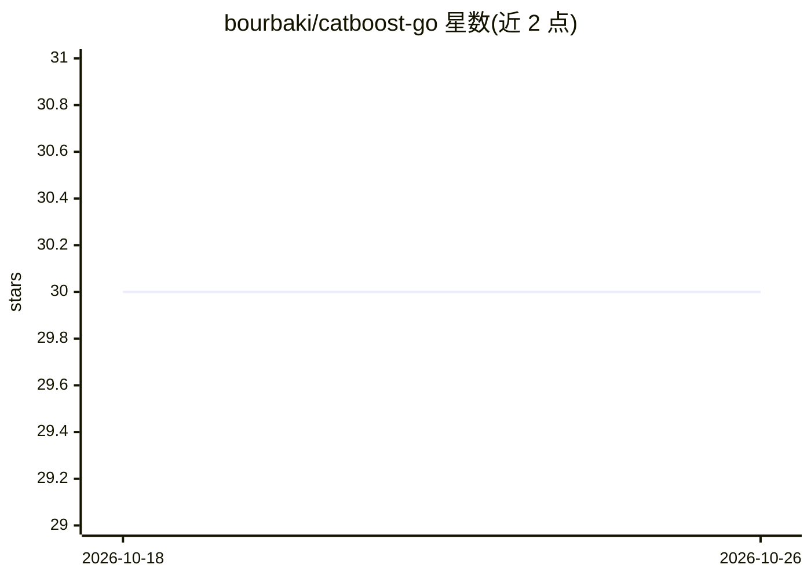

# bourbaki/catboost-go

⭐ 30 · Go · 推送 2026-08-07 · [GitHub](https://github.com/bourbaki/catboost-go) · 个人维护

**CatBoost C 库的 Go 封装，用于模型预测**

对 CatBoost C 库（model_interface）的 Go 语言封装，定位为预测（inference）用途，即加载已训练的 CatBoost 模型在 Go 程序中执行预测，而非训练。使用前需自行编译 CatBoost C 库（通过 ya make 或放置于默认搜索目录）并配置头文件与库文件路径，之后以 go get 安装本封装。README 仅含安装说明，未展示 API 示例。

## 筛选速览

| 维度 | 判定 | 备注 |
|---|---|---|
| AI 角色 | `ai-native` | 本体是模型或模型工具 |
| 许可风险 | `none` | — |
| 部署形态 | `None` |  |
| 模型依赖 | — | README 未给出锁定关系 |
| 硬件要求 | — | 无带数字的原话,不猜 |
| 安装摩擦 | `low` | 无编译、无系统依赖或容器化 |
| 成熟度 | — | 结构信号不足 |

## 能力要点

- 封装 CatBoost C 库的 model_interface 供 Go 调用
- 面向预测场景（prediction），不涉及训练
- 支持通过环境变量或默认系统目录两种方式链接 CatBoost 库

## 适用场景

- 在 Go 服务中加载 CatBoost 模型执行线上预测
- 将已有 CatBoost 模型集成到 Go 技术栈而无需切换语言

## 场景标签

`推理引擎` · 领域:训练与推理

## 证据(README 行号)

> L2: Simple wrapper of CatBoost C library for prediction
> L5: CatBoost library is assumed to be installed and all its includes and library files are assumed to be found in corres

## 星数曲线

2026-10-18 30 → 2026-10-26 30（+0）

---
*卡片 v1 · prompt 1.4 · 生成 2026-10-26 · 置信度 mid · 依据 README sha `88666c710f1d` · [字段定义](../../DATASET.md)*
