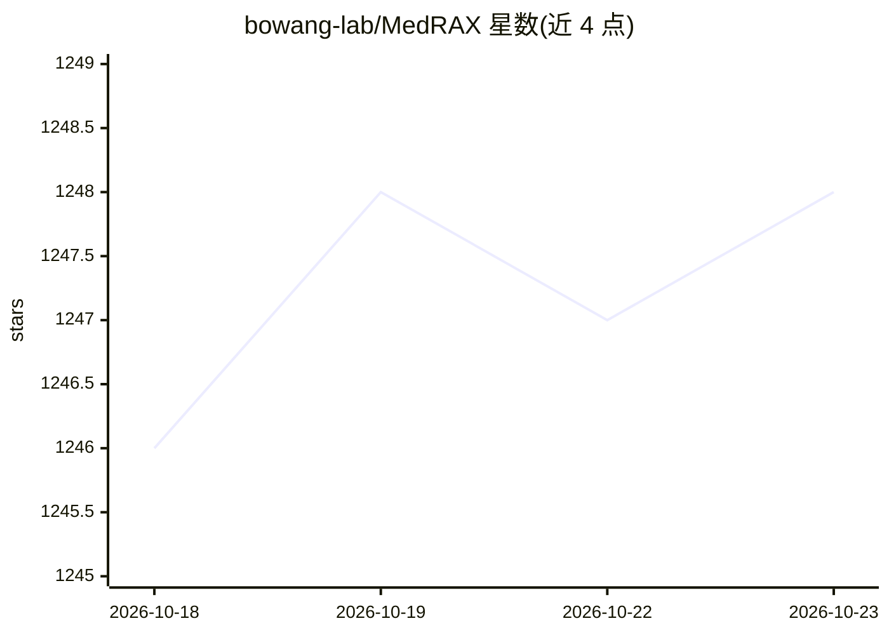

# bowang-lab/MedRAX

⭐ 1,248 · Python · Apache-2.0 · 推送 2025-10-31 · [GitHub](https://github.com/bowang-lab/MedRAX) · [官网](https://bowang-lab.github.io/MedRAX/) · 组织维护

**胸片医学推理 AI Agent，整合多种 CXR 分析工具与多模态 LLM**

面向胸片（CXR）解读的医学推理 Agent：基于 LangChain/LangGraph 构建，以 GPT-4o vision 为骨干 LLM，动态调用视觉问答（CheXagent、LLaVA-Med）、分割、病灶定位、报告生成、18 类疾病分类、X 光生成等工具，无需额外训练。提供 Gradio 界面，支持本地与云端部署，可用 OpenAI 兼容 API（含 Ollama、DashScope/Qwen3-VL）替换后端。附带 ChestAgentBench 基准（2,500 条查询、675 例临床案例）。安装需 git clone 源码并 pip install -e .，GPU 可选。

## 筛选速览

| 维度 | 判定 | 备注 |
|---|---|---|
| AI 角色 | `ai-native` | 本体是模型或模型工具 |
| 许可风险 | `permissive` | Apache-2.0 |
| 部署形态 | `library` | 以包/库形式分发 |
| 模型依赖 | local-ok | 支持本地模型 |
| 硬件要求 | — | 无带数字的原话,不猜 |
| 安装摩擦 | `medium` | 含编译或系统依赖之一 |
| 成熟度 | — | 结构信号不足 |

## 能力要点

- 整合 CheXagent/LLaVA-Med、MedSAM/PSPNet、Maira-2、TorchXrayVision DenseNet-121 等工具
- ChestAgentBench：2,500 条复杂医学查询、7 类任务的评测基准
- 支持 OpenAI 兼容 API 作为替代后端（Ollama、LM Studio、DashScope）
- Gradio 生产界面，支持选择性工具初始化与 8/4-bit 量化

## 适用场景

- 临床医生或研究者对胸片做复杂多步推理问答
- 自动生成胸片报告与病灶定位
- 在 ChestAgentBench 上评测医学影像推理模型

## 场景标签

`多模态` `模型评测` · 领域:评测与运维

## 证据(README 行号)

> L6: Chest X-rays (CXRs) play an integral role in driving critical decisions in disease management and patient care. Whil
> L17: - **Visual QA**: Utilizes CheXagent and LLaVA-Med for complex visual understanding and medical reasoning
> L21: - **Disease Classification**: Leverages DenseNet-121 from TorchXRayVision for detecting 18 pathology classes

## 星数曲线

2026-10-18 1,246 → 2026-10-23 1,248（+2）

---
*卡片 v1 · prompt 1.4 · 生成 2026-10-21 · 置信度 mid · 依据 README sha `a3a5572acf56` · [字段定义](../../DATASET.md)*
