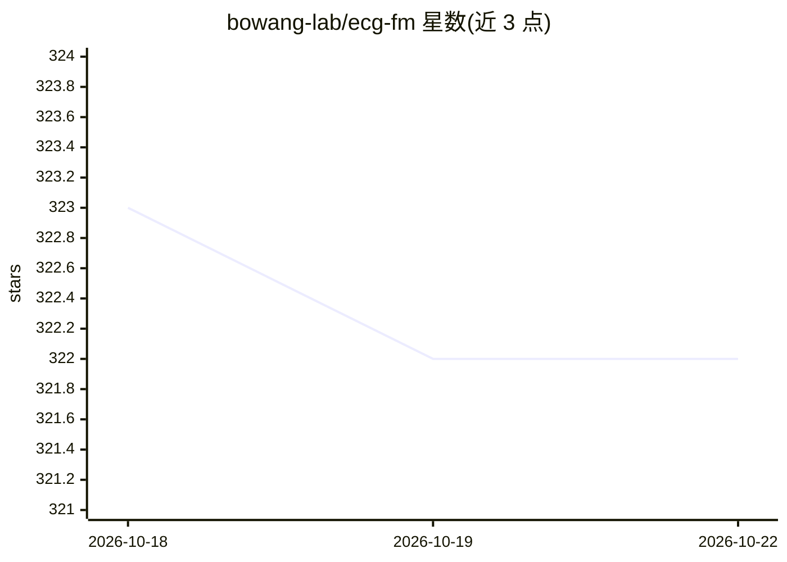

# bowang-lab/ecg-fm

⭐ 322 · Python · MIT · 推送 2026-01-14 · [GitHub](https://github.com/bowang-lab/ecg-fm) · 组织维护

**心电图（ECG）分析基础模型，供研究者做推理与微调**

ECG-FM 是面向心电图分析的基础模型，90.9M 参数，采用 wav2vec 2.0 架构，以 W2V+CMSC+RLM 方法在 MIMIC-IV-ECG v1.0 与 PhysioNet 2021 v1.0.3 上预训练，并在 MIMIC-IV-ECG 上提供微调版本。本仓库定位为落地页，训练与推理均依赖 fairseq_signals 框架执行；模型检查点在 HuggingFace 公开下载。仓库另提供多源数据预处理管线、命令行推理教程、线性探针脚本、配置文件与自由文本标签处理 notebook。安装方式为克隆 fairseq_signals 并按其 README 安装。

## 筛选速览

| 维度 | 判定 | 备注 |
|---|---|---|
| AI 角色 | `ai-native` | 本体是模型或模型工具 |
| 许可风险 | `permissive` | MIT |
| 部署形态 | `None` |  |
| 模型依赖 | — | README 未给出锁定关系 |
| 硬件要求 | — | 无带数字的原话,不猜 |
| 安装摩擦 | `low` | 无编译、无系统依赖或容器化 |
| 成熟度 | — | 结构信号不足 |

## 能力要点

- 90.9M 参数、wav2vec 2.0 架构的 ECG 基础模型
- 预训练与微调两版检查点在 HuggingFace 公开提供
- 基于 fairseq_signals 框架的预训练/微调配置与命令
- 自由文本模式匹配与知识图谱标签处理 notebook

## 适用场景

- 下载检查点对心电图数据做推理与可视化
- 基于公开配置复现或继续预训练/微调模型
- 用线性探针评估 ECG 表示质量

## 场景标签

`微调` `模型训练` · 领域:训练与推理

## 证据(README 行号)

> L4: ECG-FM is a foundation model for electrocardiogram (ECG) analysis. Committed to open-source practices, ECG-FM was de
> L23: ECG-FM has 90.9 million parameters, adopts the wav2vec 2.0 architecture, and was pretrained using the W2V+CMSC+RLM 

## 星数曲线

2026-10-18 323 → 2026-10-22 322（-1）

---
*卡片 v1 · prompt 1.4 · 生成 2026-10-21 · 置信度 high · 依据 README sha `70e9682cc705` · [字段定义](../../DATASET.md)*
