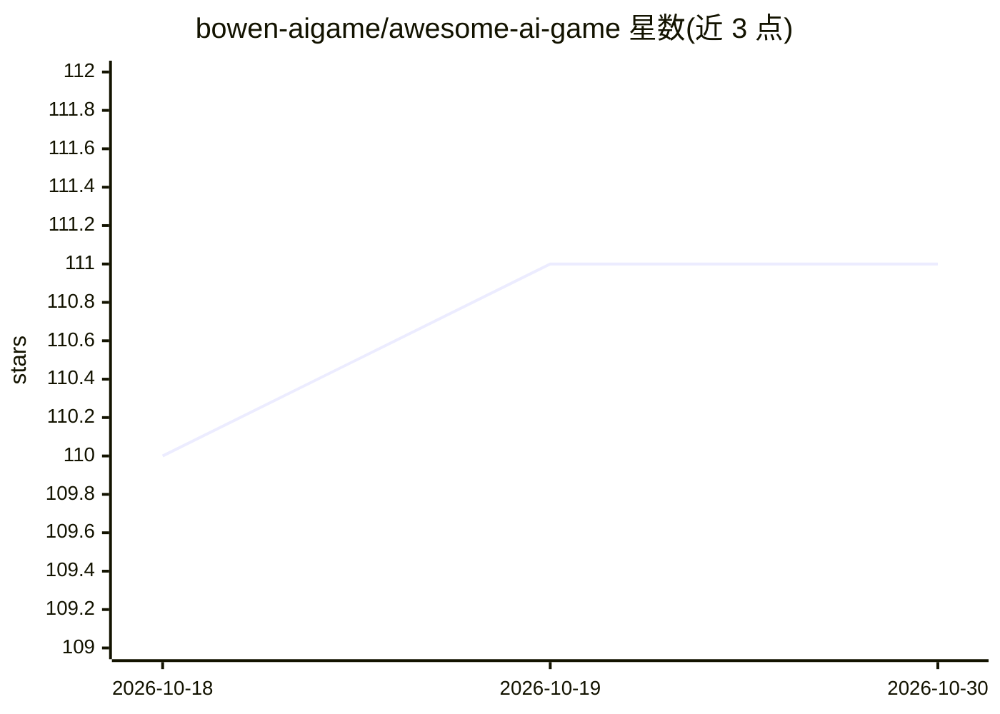

# bowen-aigame/awesome-ai-game

⭐ 111 · MIT · 推送 2026-06-13 · [GitHub](https://github.com/bowen-aigame/awesome-ai-game) · 个人维护

**可玩的 AI 游戏策展清单：AI 即玩法本身的游戏收录**

一份精选清单，收录当前可直接游玩、以 AI 为玩法核心的游戏：LLM 驱动对话的 NPC、AI 主持的跑团与文字冒险、神经网络实时生成的开放世界、AI 裁判的派对游戏等。按对话 NPC、叙事角色扮演、沙盒模拟、主流游戏中的 AI NPC 四个类别组织，每条给出热度分级（🔥三级）与一句描述，并明确排除仅用 AI 工具制作的游戏。面向玩家与 AI 游戏兴趣者，接受 PR，MIT 许可。

## 筛选速览

| 维度 | 判定 | 备注 |
|---|---|---|
| AI 角色 | `ai-knowledge` | 知识聚合/清单类 |
| 许可风险 | `permissive` | MIT |
| 部署形态 | `None` |  |
| 模型依赖 | — | README 未给出锁定关系 |
| 硬件要求 | — | 无带数字的原话,不猜 |
| 安装摩擦 | `low` | 无编译、无系统依赖或容器化 |
| 成熟度 | — | 结构信号不足 |

## 能力要点

- 四类组织：对话 NPC、AI 叙事角色扮演、沙盒/模拟/派对、主流游戏 AI NPC
- 明确收录标准：AI 须是玩法的一部分，而非仅用 AI 工具制作
- 每条含热度分级（🔥🔥🔥/🔥🔥/🔥）与一句话描述
- 标注更新时间（2026 年 6 月）并接受 PR

## 适用场景

- 寻找当前可玩的 AI NPC 或 AI 叙事类游戏
- 跟踪主流游戏中新增的 AI NPC 功能与模组
- 了解 AI 原生游戏生态的覆盖范围

## 场景标签

`精选清单` · 领域:学习与行业

## 证据(README 行号)

> L13: Gaming has moved from PC, to mobile, to the web — and now to **AI**. This list is for the player at the start of th
> L15: **What counts as an AI game here:** a game that contains a live AI element as part of play — an NPC whose dialogue 

## 星数曲线

2026-10-18 110 → 2026-10-30 111（+1）

---
*卡片 v1 · prompt 1.4 · 生成 2026-10-23 · 置信度 high · 依据 README sha `47aa5c42b147` · [字段定义](../../DATASET.md)*
