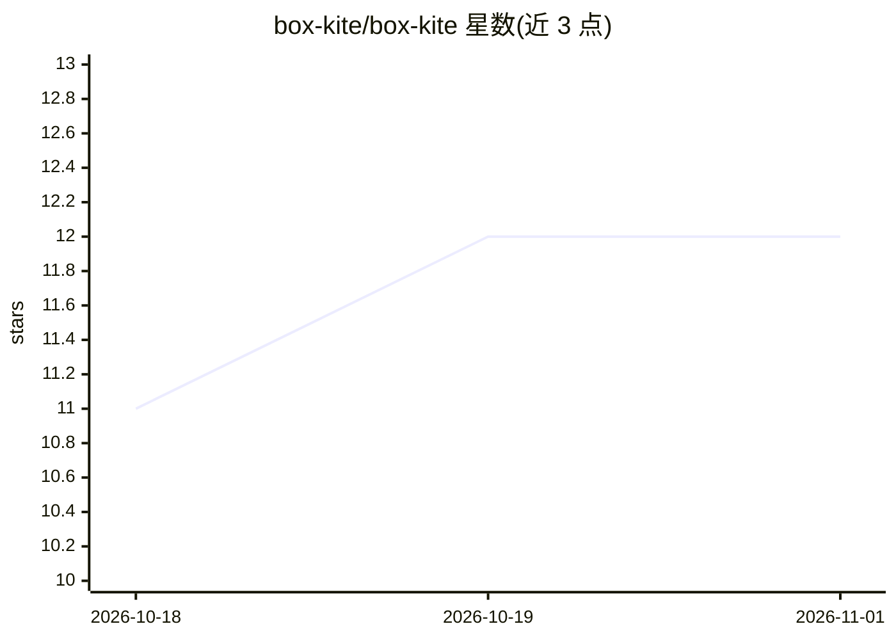

# box-kite/box-kite

⭐ 12 · TypeScript · MIT · 推送 2026-10-30 · [GitHub](https://github.com/box-kite/box-kite) · [官网](https://www.box-kite.dev/) · 组织维护

**面向 AI 编写的 React 样式组件库：235 个类型化 CSS props**

单一 React 组件 Box 提供 235 个类型化 CSS props，运行时按值生成 CSS 并按内容缓存规则，同一值全应用复用一个 class，用 TypeScript 写样式而无需 CSS 文件。配色采用 Tailwind 的 OKLCH 色板，支持渐变/阴影/滤镜等分层组合声明。附带 Form、DataGrid、Tooltip 等 APG 无障碍组件与 SVG 组件。包内附带全部 prop 规则与文档，供 AI agent 读取，并提供 npx @box-kite/mcp 的 MCP 服务，面向被 AI 编写的场景设计。支持 React 16.14+（含 18/19）。

## 筛选速览

| 维度 | 判定 | 备注 |
|---|---|---|
| AI 角色 | `ai-enhanced` | 去掉 AI 部分产品仍成立 |
| 许可风险 | `permissive` | MIT |
| 部署形态 | `library` | 以包/库形式分发 |
| 模型依赖 | — | README 未给出锁定关系 |
| 硬件要求 | — | 无带数字的原话,不猜 |
| 安装摩擦 | `low` | 无编译、无系统依赖或容器化 |
| 成熟度 | — | 结构信号不足 |

## 能力要点

- Box 组件 235 个类型化 CSS props，运行时生成并按内容缓存 CSS 规则
- 包内附带 prop 注册表生成的规则与文档，供 AI agent 读取，提供 MCP 服务
- Tailwind OKLCH 色板、渐变/四层阴影/九函数滤镜的组合式声明
- 按 APG 实现的无障碍组件：DataGrid、Tooltip、Dropdown、RadioGroup 等

## 适用场景

- React 项目中用 TypeScript 类型化 props 写样式，不写 CSS 文件
- 让 AI agent 通过 MCP 与包内文档生成 UI 代码
- 构建带键盘与 ARIA 支持的表单与数据表格

## 场景标签

`代码生成` · 领域:编码与开发

## 证据(README 行号)

> L8: `Box` is a single React component with 235 typed CSS props. It generates the CSS for the values you
> L17: **Built to be written by an AI.** The rules, every prop with the CSS it emits and a docs folder are
> L20: `npx @box-kite/mcp` ·

## 星数曲线

2026-10-18 11 → 2026-11-01 12（+1）

---
*卡片 v1 · prompt 1.4 · 生成 2026-11-01 · 置信度 high · 依据 README sha `7d9f1f4fe119` · [字段定义](../../DATASET.md)*
