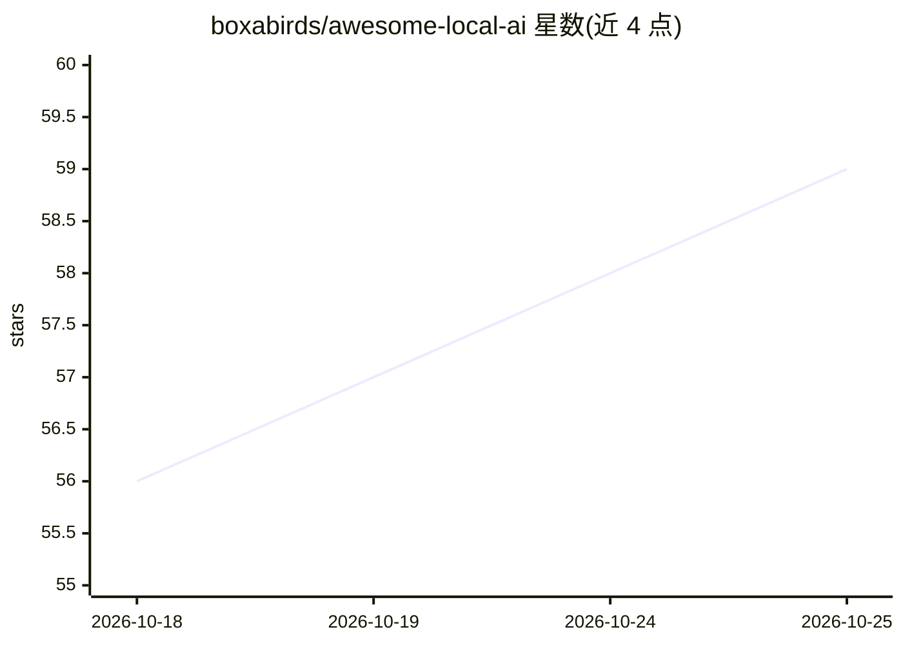

# boxabirds/awesome-local-ai

⭐ 60 · Python · Apache-2.0 · 推送 2026-10-20 · [GitHub](https://github.com/boxabirds/awesome-local-ai) · [官网](https://ailocal.substack.com) · 个人维护

**本地 AI 一键安装器集合：按硬件匹配模型+推理栈组合**

面向想在本地跑模型并接上编码 agent 的开发者：提供 install.sh 探测主机硬件（OS/内存档位），从一组'模型×系统×硬件×推理栈'的实测组合中挑选并安装，组合覆盖 Qwen3.8 系列模型与 llama.cpp、MTPLX、SGLang、gufo 等引擎，交付 OpenAI 兼容 API 并预接 OpenCode 或 pi。start.sh 负责按需启动与闲置关停。仓库另一半是基准测试：编码 agent 按规格逐故事实现，由未见过的测试集打分。限制：安装器会在未实测硬件上拒绝运行；部分组合（SGLang、mlx-serve、Strix Halo、64GB macOS）为转述或未实测，README 逐条标注。

## 筛选速览

| 维度 | 判定 | 备注 |
|---|---|---|
| AI 角色 | `ai-ecosystem` | LLM/agent 周边工具 |
| 许可风险 | `permissive` | Apache-2.0 |
| 部署形态 | `None` |  |
| 模型依赖 | local-ok | 支持本地模型 |
| 硬件要求 | `gpu-24g` | |
| 安装摩擦 | `medium` | 含编译或系统依赖之一 |
| 成熟度 | — | 结构信号不足 |

## 能力要点

- install.sh 探测硬件并从实测组合中自动选择，不满足时以数字拒绝安装
- 每行组合附带按内存档位调定的上下文窗口与真实硬件实测数据
- 每个组合提供 OpenAI 兼容端点（含工具调用）并预配置编码 agent
- 配套基准：编码 agent 实现完整规格，由 held-out 测试集评分

## 适用场景

- 在自有硬件上快速部署本地模型并通过 OpenAI 兼容 API 供编码 agent 使用
- 对比不同模型/推理栈在自己机器上的速度与内存占用
- 为本地编码 agent 选择适合内存档位的上下文窗口配置

## 场景标签

`模型评测` `精选清单` · 领域:评测与运维

## 证据(README 行号)

> L3: One-command installers for running capable models **locally**, as an
> L4: OpenAI-compatible API with a coding agent already wired up.
> L49: The repo has two halves. The installers above give you a working setup. The

## 星数曲线

2026-10-18 56 → 2026-10-25 59（+3）

---
*卡片 v1 · prompt 1.4 · 生成 2026-10-24 · 置信度 high · 依据 README sha `6026c6b5ef5d` · [字段定义](../../DATASET.md)*
