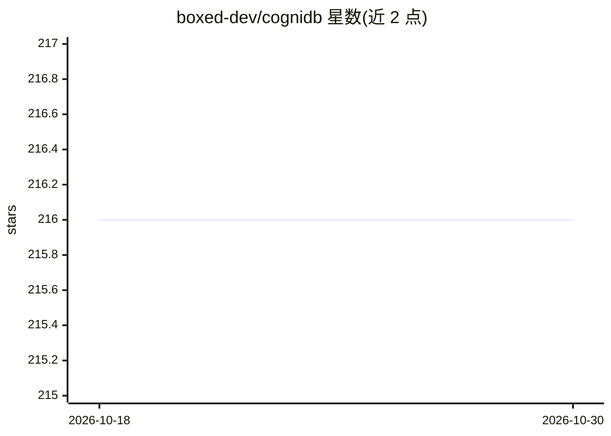

# boxed-dev/cognidb

⭐ 216 · Python · MIT · 推送 2026-08-01 · [GitHub](https://github.com/boxed-dev/cognidb) · 组织维护

**面向应用的 NL2SQL 安全层：自然语言转受控 SELECT SQL**

Python 库（非聊天产品），将自然语言转为面向 SELECT 的 SQL，支持 PostgreSQL、MySQL、SQLite。核心是安全管道：输入净化→LLM 产出结构化 QueryIntent→确定性渲染为带绑定参数的 SQL→sqlglot AST 守卫拦截 DDL/危险函数/堆叠语句→可选 fail-closed 表列白名单→参数化执行与结构化审计日志。默认意图模式；自由 SQL 需显式开启 allow_dangerous_sql。免费快速开始可离线运行（FakeIntentGenerator，无需网络 LLM）。

## 筛选速览

| 维度 | 判定 | 备注 |
|---|---|---|
| AI 角色 | `ai-ecosystem` | LLM/agent 周边工具 |
| 许可风险 | `permissive` | MIT |
| 部署形态 | `library` | 以包/库形式分发 |
| 模型依赖 | — | README 未给出锁定关系 |
| 硬件要求 | — | 无带数字的原话,不猜 |
| 安装摩擦 | `low` | 无编译、无系统依赖或容器化 |
| 成熟度 | — | 结构信号不足 |

## 能力要点

- 意图模式下 LLM 产出结构化 QueryIntent，值以绑定参数传递，不内插进 SQL
- 基于 sqlglot 的 AST 守卫，按结构拦截 DDL、管理语句、危险函数与数据修改型 CTE
- 可选 fail-closed 表/列白名单与按用户访问控制（缺 user_id 即拒绝）
- 默认只读 SELECT，写模式需显式开启，DDL 一律拒绝

## 适用场景

- 让应用内非技术用户用自然语言查询数据库且限制为只读
- 在面向用户的查询功能中加防注入与危险语句拦截层
- 为只读分析角色做表级白名单与审计

## 场景标签

`数据分析` · 领域:效率与自动化

## 证据(README 行号)

> L3: **Secure natural-language SQL for applications** — a Python **library**, not a chat product.
> L5: > CogniDB turns natural language into **SELECT-oriented SQL** against PostgreSQL, MySQL, and SQLite. Security is the
> L9: - **Intent mode is the default** — the LLM produces a structured `QueryIntent`, which is rendered deterministically 

## 星数曲线

2026-10-18 216 → 2026-10-30 216（+0）

---
*卡片 v1 · prompt 1.4 · 生成 2026-10-22 · 置信度 high · 依据 README sha `190b52608ff0` · [字段定义](../../DATASET.md)*
