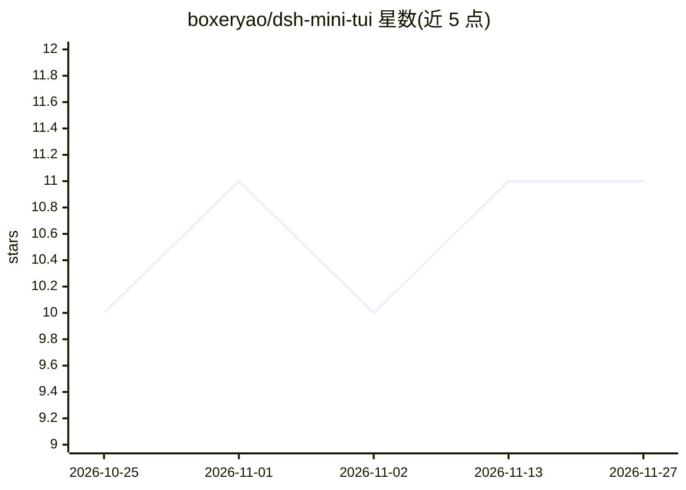

# boxeryao/dsh-mini-tui

⭐ 11 · TypeScript · MIT · 推送 2026-08-16 · [GitHub](https://github.com/boxeryao/dsh-mini-tui) · 个人维护 · 中文 README

**DeepSeek Harness 的极简终端 UI 插件：聚焦输入与回答**

作为 DeepSeek Harness（DSH）的终端表现层插件，保留 Agent 与工具能力但默认把执行过程收进后台，终端主要呈现用户输入与模型最终回答。提供 /verbose、/tool N 按需查看工具调用详情，深海配色与路径着色界面，Windows 资源管理器右键菜单安装器。安装/移除只改变 DSH 交互界面，模型路由、审批、Session 持久化仍由 DSH 提供；需 Node.js 22.19+/pnpm 11+ 与 DSH 0.1.0-rc.6 及已配置的模型凭据。

## 筛选速览

| 维度 | 判定 | 备注 |
|---|---|---|
| AI 角色 | `ai-ecosystem` | LLM/agent 周边工具 |
| 许可风险 | `permissive` | MIT |
| 部署形态 | `library` | 以包/库形式分发 |
| 模型依赖 | — | README 未给出锁定关系 |
| 硬件要求 | — | 无带数字的原话,不猜 |
| 安装摩擦 | `low` | 无编译、无系统依赖或容器化 |
| 成熟度 | — | 结构信号不足 |

## 能力要点

- answer-first 对话布局：工具调用默认静默，/verbose 与 /tool N 按需查看过程
- 通过 dsh plugin --profile tui 命令以 npm 包形式安装到 DSH
- 内置 Windows 资源管理器右键菜单安装器，仅写 HKEY_CURRENT_USER
- 完整执行记录由 DSH Session 日志持久化

## 适用场景

- 在终端中使用 DeepSeek Harness 时获得更少滚屏的对话界面
- 需要时排查工具调用详情但默认专注模型回答
- 在 Windows 资源管理器中右键直接于某目录启动 DSH 终端会话

## 场景标签

`编码 Agent` · 领域:编码与开发

## 证据(README 行号)

> L15: **DSH Mini TUI 是 DeepSeek Harness 的终端表现层插件，不是独立的 Agent 框架。** 它决定用户在终端里如何输入、查看状态和阅读回答；模型与 Agent 如何运行，仍由 DSH 负责。
> L128: 本仓库只负责终端展示插件。模型路由、工具、权限、持久化和 Agent 执行由 DSH 提供。TUI 采用行式界面，不提供 Web 客户端的图形卡片、会话导航或全屏滚动区。

## 星数曲线

2026-10-25 10 → 2026-11-27 11（+1）

---
*卡片 v1 · prompt 1.4 · 生成 2026-11-18 · 置信度 high · 依据 README sha `73df84130c9f` · [字段定义](../../DATASET.md)*
