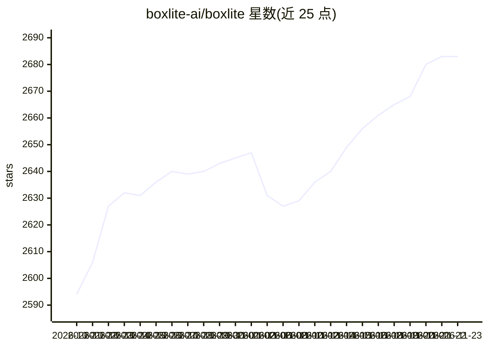

# boxlite-ai/boxlite

⭐ 2,683 · TypeScript · Apache-2.0 · 推送 2026-11-22 · [GitHub](https://github.com/boxlite-ai/boxlite) · [官网](https://boxlite.ai/) · 组织维护

**为 AI agent 提供可嵌入的硬件隔离 micro-VM 沙箱运行时**

以库/CLI/服务器三种形态提供的 micro-VM 运行时，为 AI agent 执行代码与文件操作提供隔离环境：每个 Box 运行任意 OCI 镜像、拥有独立内核，支持跨回合持久化（安装的包与文件保留）、egress 白名单与 secret 注入、QCOW2 磁盘与卷挂载。提供 Python/Node/Go/Rust/C SDK 与 REST API，可部署到 AWS/GCP 构建多租户 agentic cloud。依赖 KVM 或 Hypervisor.framework 硬件虚拟化，不支持无 KVM 的传统 Windows。

## 筛选速览

| 维度 | 判定 | 备注 |
|---|---|---|
| AI 角色 | `ai-ecosystem` | LLM/agent 周边工具 |
| 许可风险 | `permissive` | Apache-2.0 |
| 部署形态 | `library` | 以包/库形式分发 |
| 模型依赖 | — | README 未给出锁定关系 |
| 硬件要求 | — | 无带数字的原话,不猜 |
| 安装摩擦 | `low` | 无编译、无系统依赖或容器化 |
| 成熟度 | — | 结构信号不足 |

## 能力要点

- 嵌入式库形态：无守护进程、无需 root，支持 Python/Node/Go/Rust/C SDK
- 每个 Box 为硬件隔离 micro-VM，运行任意 OCI 镜像且状态跨重启持久化
- egress allow-list 与 host 代理 secret 注入，真实密钥不进入 VM
- 可部署为 REST 服务器并分发到自有 AWS/GCP 账户

## 适用场景

- 给 agent 生成的代码提供隔离执行环境
- 在笔记本上本地运行沙箱化的 agent 工作负载
- 自建多租户 agentic cloud，按需部署 VM runner 集群

## 场景标签

 · 领域:AI 基础设施/沙箱运行时

## 证据(README 行号)

> L11:  The compute substrate for AI agents — light enough to embed on your laptop, elastic enough to power an agentic clo
> L124: |**Isolation & security**|a hardware-virtualized VM per box (KVM / Hypervisor.framework) · OS sandbox (seccomp / s
> L133: Agent frameworks run on BoxLite:

## 星数曲线

2026-10-21 2,594 → 2026-11-23 2,683（+89）

---
*卡片 v1 · prompt 1.4 · 生成 2026-11-23 · 置信度 high · 依据 README sha `deefcad988dc` · [字段定义](../../DATASET.md)*
