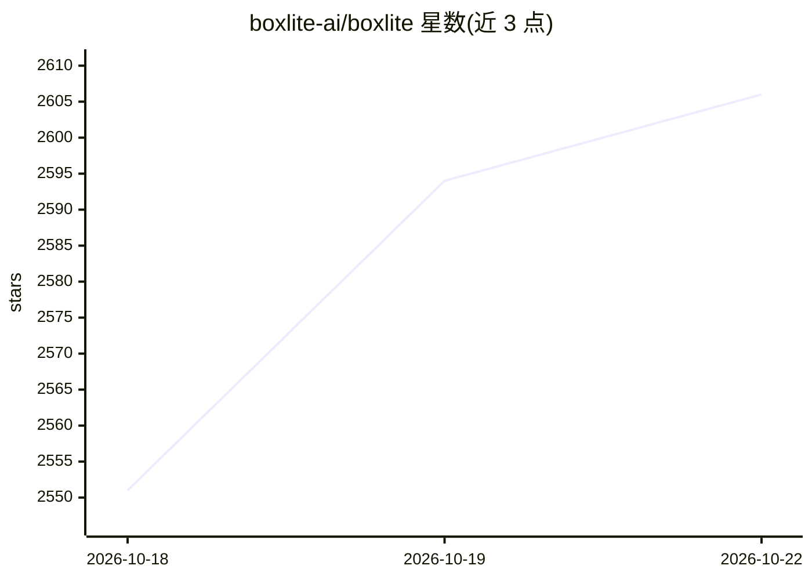

# boxlite-ai/boxlite

⭐ 2,606 · TypeScript · Apache-2.0 · 推送 2026-10-21 · [GitHub](https://github.com/boxlite-ai/boxlite) · [官网](https://boxlite.ai/) · 组织维护

**面向 AI agent 的硬件隔离微 VM 运行时，可嵌入可云端部署**

BoxLite 是一个用 Rust 编写的计算基底，为 AI agent 提供硬件隔离的 micro-VM（每个 Box 独立内核，基于 KVM/Hypervisor.framework），可运行任意 OCI 镜像并在 stop/restart 间持久化状态。提供四种形态：作为库嵌入应用（Python/Node.js/Go/Rust/C SDK，无守护进程无需 root）、CLI 二进制一键运行、独立 REST 服务器，以及部署到自有 AWS/GCP 账号的 agentic cloud。安全层包括 OS 级沙箱（seccomp/sandbox-exec）、出站白名单、秘密注入与资源限额。平台支持 macOS Apple Silicon、Linux x86_64/ARM64、Windows WSL2；macOS Intel 尚未支持。Apache-2.0 许可。

## 筛选速览

| 维度 | 判定 | 备注 |
|---|---|---|
| AI 角色 | `ai-ecosystem` | LLM/agent 周边工具 |
| 许可风险 | `permissive` | Apache-2.0 |
| 部署形态 | `library` | 以包/库形式分发 |
| 模型依赖 | — | README 未给出锁定关系 |
| 硬件要求 | — | 无带数字的原话,不猜 |
| 安装摩擦 | `low` | 无编译、无系统依赖或容器化 |
| 成熟度 | — | 结构信号不足 |

## 能力要点

- 每个 Box 一个硬件虚拟化 micro-VM，运行任意 OCI 镜像且状态跨回合持久
- Daemonless 库式嵌入：无 root、无后台服务；另有可选 server 模式
- 多层隔离：KVM/Hypervisor.framework + seccomp/sandbox-exec + egress 白名单 + 秘密注入
- 五种语言 SDK、CLI、REST API 三类接口；支持部署为多租户 agentic cloud

## 适用场景

- 让 agent 在隔离沙箱里执行代码、安装包并跨回合恢复状态
- 从笔记本嵌入扩展到自有 AWS/GCP 上的 agent 云
- 以 REST 服务形式为多个 agent 提供可管理的执行沙箱

## 场景标签

`Agent 框架` · 领域:Agent 开发

## 证据(README 行号)

> L11:  The compute substrate for AI agents — light enough to embed on your laptop, elastic enough to power an agentic clo
> L15: A **Box** is a hardware-isolated micro-VM that runs any OCI image — and it persists. Agents install packages, write
> L31: Import BoxLite and give your agent an isolated VM to run code — no daemon, no binary. *(Python 3.10+)*

## 星数曲线

2026-10-18 2,551 → 2026-10-22 2,606（+55）

---
*卡片 v1 · prompt 1.4 · 生成 2026-10-21 · 置信度 high · 依据 README sha `697cd81b3089` · [字段定义](../../DATASET.md)*
