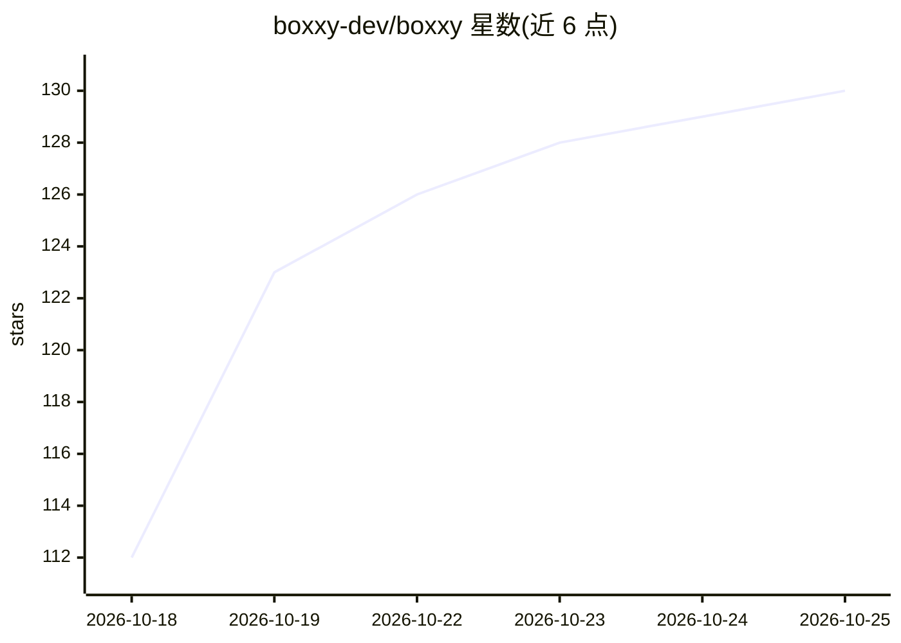

# boxxy-dev/boxxy

⭐ 130 · Rust · 推送 2026-10-25 · [GitHub](https://github.com/boxxy-dev/boxxy) · [官网](https://boxxy.dev) · 组织维护

**内建 AI agent 层的 Linux 终端模拟器**

GTK4/libAdwaita 构建的 Linux 终端模拟器，叠加名为 BoxxyClaw 的 agent 层：读取终端缓冲区、记忆用户偏好，可自主修复依赖、管理系统配置、运行脚本，通过 Ctrl+/ 唤起。架构分四个 crate（UI、宿主 daemon、纯 Rust 无头终端引擎、agent 智能层）。支持 Gemini、Anthropic、OpenAI、DeepSeek、Ollama、OpenRouter 及 OpenAI 兼容端点，并提供 Native Nightly 安装脚本与 Flatpak Nightly 两种安装方式；当前处于 Preview 阶段，Native 版要求 GTK 4.24 与 libAdwaita 1.10。

## 筛选速览

| 维度 | 判定 | 备注 |
|---|---|---|
| AI 角色 | `ai-enhanced` | 去掉 AI 部分产品仍成立 |
| 许可风险 | `none` | — |
| 部署形态 | `None` |  |
| 模型依赖 | local-ok | 支持本地模型 |
| 硬件要求 | — | 无带数字的原话,不猜 |
| 安装摩擦 | `low` | 无编译、无系统依赖或容器化 |
| 成熟度 | `idea` | |

## 能力要点

- BoxxyClaw agent 层可读取终端缓冲区并自主执行修复依赖、管理配置等操作
- 支持 Gemini/Anthropic/OpenAI/DeepSeek/Ollama/OpenRouter/OpenAI 兼容端点
- 纯 Rust 无头终端引擎（boxxy-vte）与 D-Bus IPC 宿主 daemon 架构
- 文档含 Characters、Skills、MCP Support 章节

## 适用场景

- 在日常终端里用自然语言让 agent 修复依赖或跑脚本
- 本地 Ollama 模型驱动终端内的 agent 操作
- 通过 MCP 与技能扩展 agent 能力

## 场景标签

`GUI 自动化` · 领域:效率与自动化

## 证据(README 行号)

> L7: Boxxy is a full terminal emulator with an agentic AI layer — **BoxxyClaw** — built directly into it. Unlike chat-win
> L30: |`boxxy-agent`|Host-level daemon — PTY management, shell tools, character claims, D-Bus IPC|

## 星数曲线

2026-10-18 112 → 2026-10-25 130（+18）

---
*卡片 v1 · prompt 1.4 · 生成 2026-10-23 · 置信度 high · 依据 README sha `916beff5bad2` · [字段定义](../../DATASET.md)*
