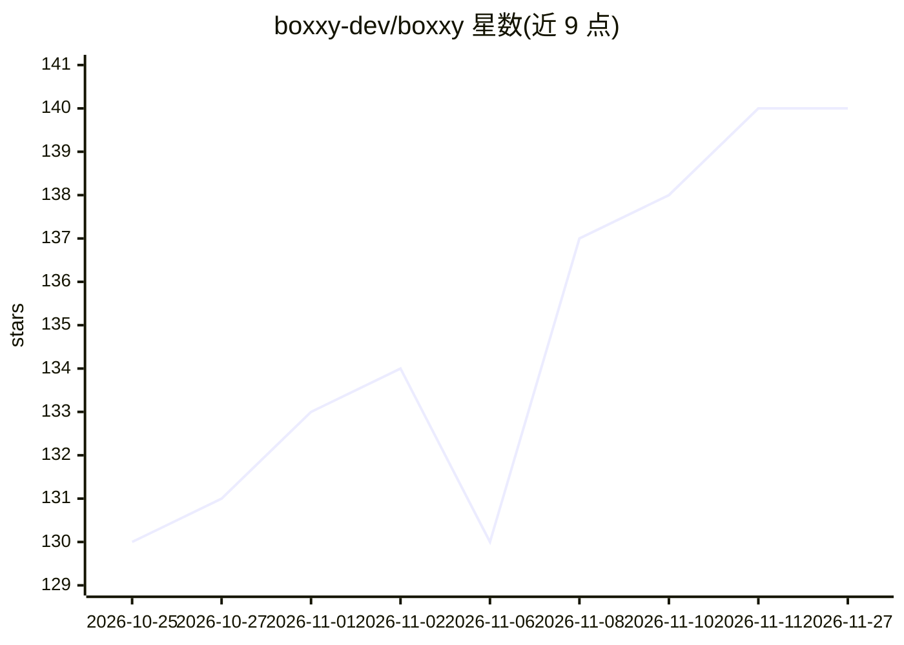

# boxxy-dev/boxxy

⭐ 140 · Rust · 推送 2026-11-26 · [GitHub](https://github.com/boxxy-dev/boxxy) · [官网](https://boxxy.dev) · 组织维护

**内置 AI agent 层的 Linux 终端模拟器**

一个完整的 GPU 渲染终端模拟器（GTK4/Libadwaita），内置名为 BoxxyClaw 的 agentic AI 层：读取终端缓冲区、记忆用户偏好，可执行修复依赖、管理系统配置、运行脚本等操作，通过 Ctrl+/ 唤起。架构上分为前端与宿主 D-Bus 守护进程，使会话在窗口关闭与 Flatpak 沙箱下持续存在；包含多 provider LLM 层（rig）与 MCP 客户端。提供原生脚本、Flatpak、Nix 三种安装方式，要求 GTK 4.24+。

## 筛选速览

| 维度 | 判定 | 备注 |
|---|---|---|
| AI 角色 | `ai-enhanced` | 去掉 AI 部分产品仍成立 |
| 许可风险 | `none` | — |
| 部署形态 | `None` |  |
| 模型依赖 | — | README 未给出锁定关系 |
| 硬件要求 | — | 无带数字的原话,不猜 |
| 安装摩擦 | `low` | 无编译、无系统依赖或容器化 |
| 成熟度 | — | 结构信号不足 |

## 能力要点

- 完整终端模拟器内置 BoxxyClaw agentic AI 层，可读取终端缓冲区并自主执行修复/配置/脚本任务
- GPU 渲染 GTK4 前端与宿主 D-Bus 守护进程分离，会话在窗口关闭与 Flatpak 沙箱下存活
- 统一多 provider LLM 层（rig）与 Stdio/HTTP MCP 客户端
- 含 FTS5 记忆召回、skills、swarm 工具与审批机制

## 适用场景

- 在终端内用自然语言让 AI 修复损坏的依赖或管理系统配置
- 需要一个带 AI 助手与会话持久化的 Linux 终端
- 通过 MCP 与多 provider 接入 LLM 能力

## 场景标签

`AI 助手` · 领域:对话与助手

## 证据(README 行号)

> L3: **A self-improving Linux terminal powered by AI characters.**
> L7: Boxxy is a full terminal emulator with an agentic AI layer — **BoxxyClaw** — built directly into it. Unlike chat-win
> L34: Boxxy splits a GPU-rendered GTK4/Libadwaita frontend from a host-privileged D-Bus daemon so running shells, charact

## 星数曲线

2026-10-25 130 → 2026-11-27 140（+10）

---
*卡片 v1 · prompt 1.4 · 生成 2026-11-27 · 置信度 high · 依据 README sha `f535749d49f8` · [字段定义](../../DATASET.md)*
