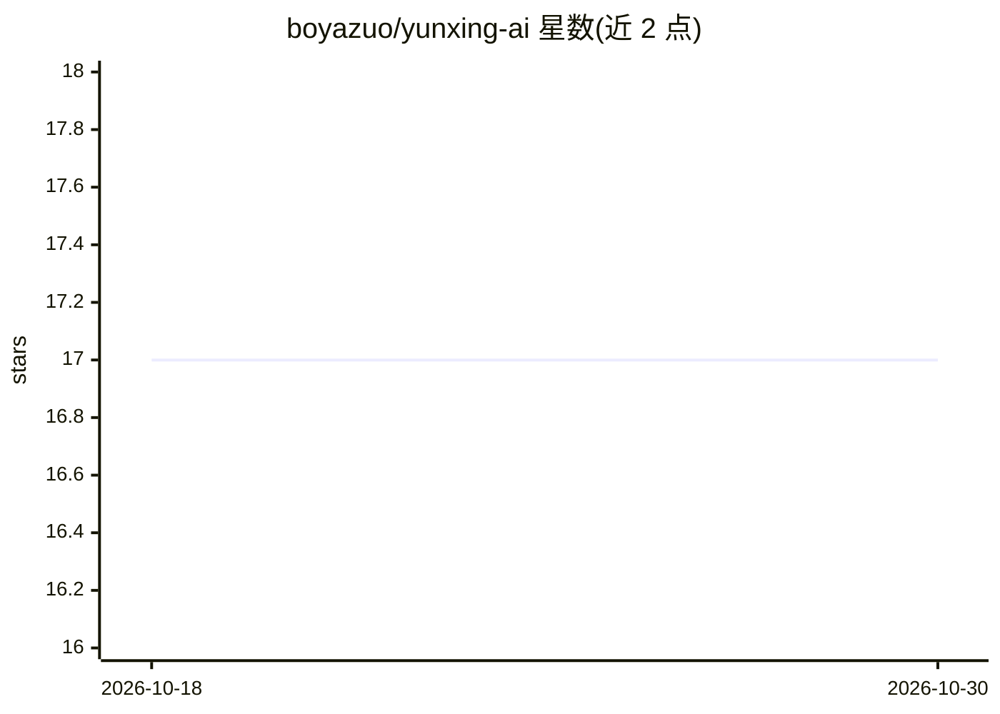

# boyazuo/yunxing-ai

⭐ 17 · TypeScript · MIT · 推送 2026-06-04 · [GitHub](https://github.com/boyazuo/yunxing-ai) · 组织维护 · 中文 README

**面向开发者的 AI 应用构建平台：多租户、RAG 知识库与流式对话**

前后端分离的开源 AI 应用构建平台：Next.js 15 + React 19 前端，Java 17 + Spring Boot 3.5 后端。功能覆盖多租户账户与权限、AI 应用创建与配置（系统提示词、变量、知识库绑定）、基于 SSE 的流式对话、RAG 知识库（PDF/Word 解析、Parent-Child 分段、Qdrant 向量检索、严格模式问答）与本地/阿里云 OSS 文件管理。AI 集成基于 Spring AI 1.1.6，支持智谱 AI、Ollama、OpenAI 兼容接口与 DashScope。自述处于起步阶段，需自行搭建 MySQL、Redis、Qdrant 等依赖并从源码构建运行。

## 筛选速览

| 维度 | 判定 | 备注 |
|---|---|---|
| AI 角色 | `ai-ecosystem` | LLM/agent 周边工具 |
| 许可风险 | `permissive` | MIT |
| 部署形态 | `self-host` | docker 或自建部署 |
| 模型依赖 | local-ok | 支持本地模型 |
| 硬件要求 | — | 无带数字的原话,不猜 |
| 安装摩擦 | `low` | 无编译、无系统依赖或容器化 |
| 成熟度 | `idea` | |

## 能力要点

- RAG 知识库：PDF/Word 解析、多种分段策略、Qdrant 向量检索与严格模式问答
- 基于 WebFlux/SSE 的流式对话
- Spring AI 多 Provider 支持（智谱 AI、Ollama、OpenAI 兼容、DashScope）
- 多租户（工作空间）管理与 Spring Security + JWT 认证

## 适用场景

- 搭建带知识库问答的 AI 对话应用
- 团队以多租户工作空间方式管理 AI 应用与成员权限
- 上传企业文档构建 RAG 问答知识库

## 场景标签

`RAG` `文档问答` `聊天机器人` · 领域:对话与助手

## 证据(README 行号)

> L10: - **AI 应用构建**：应用创建与配置、系统提示词、变量、知识库绑定
> L51: - **AI 集成**：Spring AI 1.1.6（智谱 AI、Ollama、OpenAI 兼容 / DashScope）
> L162: - **Spring AI 集成**：智谱 AI、DashScope、Ollama 等多 Provider 支持

## 星数曲线

2026-10-18 17 → 2026-10-30 17（+0）

---
*卡片 v1 · prompt 1.4 · 生成 2026-10-29 · 置信度 mid · 依据 README sha `def00bdef8be` · [字段定义](../../DATASET.md)*
