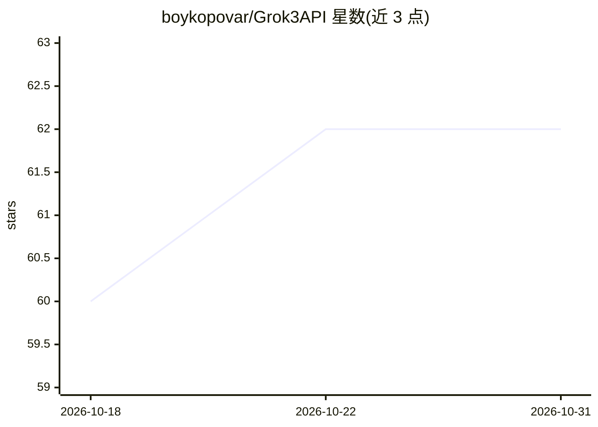

# boykopovar/Grok3API

⭐ 62 · Python · MIT · 推送 2026-06-30 · [GitHub](https://github.com/boykopovar/Grok3API) · 个人维护

**逆向工程的 Grok 移动端 gRPC 异步 Python 客户端**

面向开发者的异步 Python 库，通过逆向工程获取的移动端 gRPC 私有通道与 Grok 交互：发送消息、流式获取响应、解析 protobuf 数据块并返回类型化 Pydantic 模型。提供 new_ask_stream() 流式与 new_ask() 常规请求两种接口，覆盖 web 搜索、X 搜索、RAG、图像/视频/音频生成等工具响应的解析模型。模型字段与原始 protobuf API 响应一一对应，不做简化或字段重命名。要求 Python 3.8+，依赖 aiohttp 与 coincurve。项目声明与 xAI 无关、非官方 SDK。

## 筛选速览

| 维度 | 判定 | 备注 |
|---|---|---|
| AI 角色 | `ai-ecosystem` | LLM/agent 周边工具 |
| 许可风险 | `permissive` | MIT |
| 部署形态 | `library` | 以包/库形式分发 |
| 模型依赖 | — | README 未给出锁定关系 |
| 硬件要求 | — | 无带数字的原话,不猜 |
| 安装摩擦 | `low` | 无编译、无系统依赖或容器化 |
| 成熟度 | — | 结构信号不足 |

## 能力要点

- 异步客户端，支持流式响应（new_ask_stream）与常规请求（new_ask）
- protobuf/gRPC 帧封装与流式数据块解析，输出类型化 Pydantic 模型
- 支持解析 web 搜索、X/Twitter 搜索、RAG、图像/视频/音频生成等工具响应
- 模型与原始 protobuf API 响应完全对应，无简化结构与字段重命名

## 适用场景

- 在自己的 Python 程序中调用 Grok 发送消息并获取流式回答
- 解析 Grok 回复中的搜索结果、工具调用与元数据
- 构建基于 Grok 移动端 API 的对话或自动化应用

## 场景标签

 · 领域:LLM API 客户端

## 证据(README 行号)

> L10: An asynchronous library for interacting with Grok via the mobile gRPC channel: sending messages, streaming response
> L137: This is an independent implementation of the mobile Grok API obtained through reverse engineering.

## 星数曲线

2026-10-18 60 → 2026-10-31 62（+2）

---
*卡片 v1 · prompt 1.4 · 生成 2026-10-24 · 置信度 high · 依据 README sha `2f26438dce1f` · [字段定义](../../DATASET.md)*
