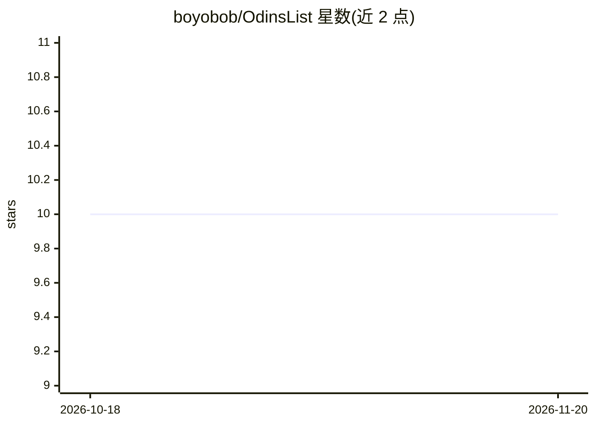

# boyobob/OdinsList

⭐ 10 · TypeScript · MIT · 推送 2026-03-10 · [GitHub](https://github.com/boyobob/OdinsList) · 个人维护

**漫画收藏的自动化编目工具：从封面图识别生成结构化目录**

基于 OpenTUI 的交互式 TUI 与 headless CLI 双模式工具：用视觉语言模型读取漫画封面图提取元数据，再与本地 GCD SQLite 数据库及 ComicVine API 交叉验证，输出带置信度分级（high/medium/low）的 TSV 结构化目录。支持按 Box_XX 文件夹组织的批量处理、暂停续跑、封面图与数据库封面图的视觉比对匹配。依赖用户自备的 OpenAI 兼容 VLM API 端点、ComicVine API key 与 GCD 数据库文件；发布二进制支持 Linux/macOS x64/arm64。

## 筛选速览

| 维度 | 判定 | 备注 |
|---|---|---|
| AI 角色 | `ai-native` | 本体是模型或模型工具 |
| 许可风险 | `permissive` | MIT |
| 部署形态 | `None` |  |
| 模型依赖 | local-ok | 支持本地模型 |
| 硬件要求 | — | 无带数字的原话,不猜 |
| 安装摩擦 | `low` | 无编译、无系统依赖或容器化 |
| 成熟度 | — | 结构信号不足 |

## 能力要点

- VLM 读取封面图提取元数据，GCD+ComicVine 双数据源交叉验证
- 每条结果输出 high/medium/low 置信度分级与评分区间
- 批量处理、暂停续跑与基于 (box, filename) 的去重更新
- 兼容任何经 OpenAI 兼容 API 提供的视觉模型

## 适用场景

- 给整箱漫画拍照后批量生成收藏目录 TSV
- 减少漫画手工录入，仅对 low 置信度结果人工复核
- 离线优先：本地 GCD 数据库完成大部分匹配

## 场景标签

`文档解析` · 领域:知识与检索

## 证据(README 行号)

> L5: OdinsList is an automated comic cataloging tool with an interactive TUI built on OpenTUI. (TUI screenshots available
> L11: - **Vision-based extraction** — Uses a vision-language model to read comic covers and extract metadata
> L188: Any vision-capable model served via an OpenAI-compatible API:

## 星数曲线

2026-10-18 10 → 2026-11-20 10（+0）

---
*卡片 v1 · prompt 1.4 · 生成 2026-11-19 · 置信度 high · 依据 README sha `a31667ffc74a` · [字段定义](../../DATASET.md)*
