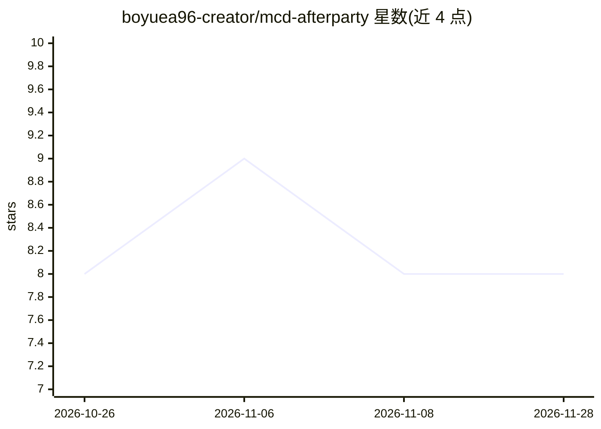

# boyuea96-creator/mcd-afterparty

⭐ 8 · HTML · MIT · 推送 2026-10-20 · [GitHub](https://github.com/boyuea96-creator/mcd-afterparty) · [官网](https://boyuea96-creator.github.io/mcd-afterparty/) · 个人维护 · 中文 README

**给散场人群算清麦当劳堂食/外卖两套真价方案的工具**

面向演唱会等大型活动散场后的多人就餐决策场景：填入地址、时间、人数等条件后，通过麦当劳 MCP 真实试价与高德地图 POI/路线接口，输出堂食与外卖两套价格、四种交通方式的时长与花费，并以一句话结论加行动卡呈现。全程只读、不代下单，不写入任何接口。纯 Python 标准库实现，无需 pip 安装，本地 git clone 后直接运行；另含给 AI Agent 用的 Skill 目录与零 Key 的快照回放演示页。

## 筛选速览

| 维度 | 判定 | 备注 |
|---|---|---|
| AI 角色 | `ai-ecosystem` | LLM/agent 周边工具 |
| 许可风险 | `permissive` | MIT |
| 部署形态 | `library` | 以包/库形式分发 |
| 模型依赖 | — | README 未给出锁定关系 |
| 硬件要求 | — | 无带数字的原话,不猜 |
| 安装摩擦 | `low` | 无编译、无系统依赖或容器化 |
| 成熟度 | — | 结构信号不足 |

## 能力要点

- 麦当劳 MCP calculate-price 真实试价，堂食/外卖两套账并列输出
- 接入高德 POI 与路线接口，计算四种交通方式的总时长与全队花费
- 纯 Python 标准库运行，无需 pip 安装依赖
- 提供面向 AI Agent 的 Skill 发布目录与 pre-commit 同步检查

## 适用场景

- 演唱会散场后给一群人算去哪家麦当劳吃最划算
- 对比同一单堂食和外卖的真实价差再决定怎么点
- 把点餐决策能力挂载到 AI Agent 的 Skill 中使用

## 场景标签

 · 领域:生活服务/决策辅助

## 证据(README 行号)

> L126: ├── skill/                  # 参赛主体：给 AI Agent 用的 Skill
> L114: ③ 试价      把套餐 / 单品 / 随心配 / 券组合全部丢给 calculate-price 真试一遍，

## 星数曲线

2026-10-26 8 → 2026-11-28 8（+0）

---
*卡片 v1 · prompt 1.4 · 生成 2026-11-20 · 置信度 low · 依据 README sha `323c30b92015` · [字段定义](../../DATASET.md)*
