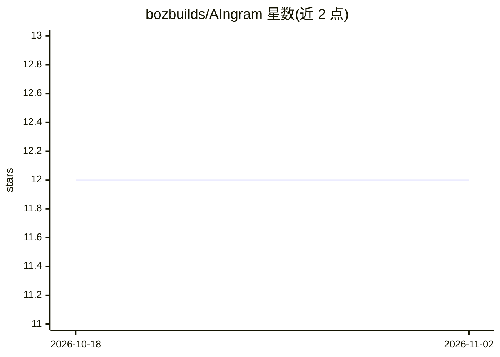

# bozbuilds/AIngram

⭐ 12 · Python · Apache-2.0 · 推送 2026-04-27 · [GitHub](https://github.com/bozbuilds/AIngram) · [官网](https://aingram.dev) · 个人维护

**单 SQLite 文件的本地 agent 记忆存储：三路混合检索+知识图谱**

面向 AI agent 开发者的本地优先记忆系统：全文检索（FTS5）、向量检索（sqlite-vec + QJL 两趟压缩，本地 ONNX nomic-embed-text-v1.5）与知识图谱遍历同时运行，经 Reciprocal Rank Fusion 融合排序。全部数据（条目、向量、实体图、Ed25519 签名链）存于一个 SQLite 文件，无云端依赖与 API key。可选功能：GLiNER 实体抽取、基于 DeBERTa NLI 的矛盾检测、需 Ollama 的合并与知识综合、MCP server、多 agent 共库与捕获守护进程。Python 库 + CLI 形式提供，附 LongMemEval/BEIR 基准数据。

## 筛选速览

| 维度 | 判定 | 备注 |
|---|---|---|
| AI 角色 | `ai-ecosystem` | LLM/agent 周边工具 |
| 许可风险 | `permissive` | Apache-2.0 |
| 部署形态 | `library` | 以包/库形式分发 |
| 模型依赖 | local-ok | 支持本地模型 |
| 硬件要求 | — | 无带数字的原话,不猜 |
| 安装摩擦 | `medium` | 含编译或系统依赖之一 |
| 成熟度 | — | 结构信号不足 |

## 能力要点

- FTS5 + sqlite-vec/QJL + 知识图谱三路检索经 RRF 融合
- 全部数据存于单个 SQLite 文件，含 Ed25519 签名与防篡改哈希链
- 可选 MCP server 接入 Claude/Cursor/Windsurf/Cline 等 agent
- 记忆巩固流程：衰减、矛盾检测（本地 DeBERTa NLI）、合并与知识综合（需 Ollama）

## 适用场景

- 为 AI agent 提供可迁移、可备份的本地长期记忆
- 多 agent 共享同一记忆文件并按 agent 归因
- 捕获 Claude Code/Cursor 等工具的提示与响应自动入记忆

## 场景标签

`Agent 记忆` `知识图谱` · 领域:Agent 开发

## 证据(README 行号)

> L16: Aingram is different. It runs **three retrieval signals simultaneously** — full-text search, semantic vector search
> L166: ## MCP Server
> L168: Install `aingram[mcp]` and connect any MCP-compatible agent (Claude, Cursor, Windsurf, Cline) to your memory store

## 星数曲线

2026-10-18 12 → 2026-11-02 12（+0）

---
*卡片 v1 · prompt 1.4 · 生成 2026-11-01 · 置信度 high · 依据 README sha `5e92dd87bdbe` · [字段定义](../../DATASET.md)*
