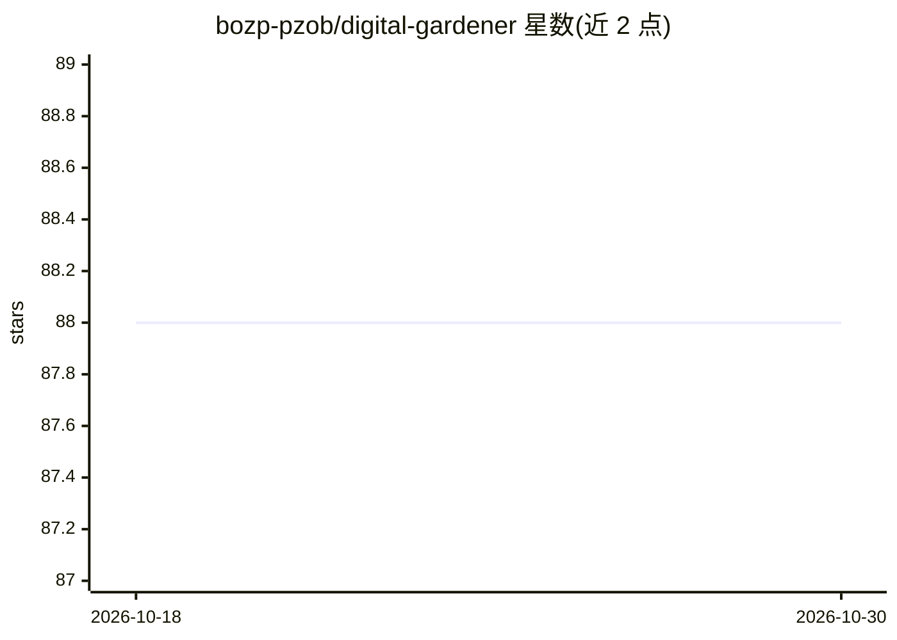

# bozp-pzob/digital-gardener

⭐ 88 · TypeScript · 推送 2026-04-07 · [GitHub](https://github.com/bozp-pzob/digital-gardener) · [官网](https://digitalgardener.io) · 组织维护

**从多源采集内容并用 AI 汇总的 TypeScript 聚合系统**

模块化 TypeScript 系统，通过插件架构从 Discord、GitHub、加密货币分析 API（Solana/CoinGecko/Codex）及通用 REST 端点采集内容，用可配置的 AI 提供商（OpenAI/OpenRouter）做自动摘要，含 token 超限自动回退模型、可选的主题提取与图像/Meme 生成（Imgflip）。数据存入 SQLite（可加密），摘要输出 JSON 与 Markdown，支持历史数据回溯处理、媒体下载与 Bunny CDN 上传。可通过 GitHub Actions 定时运行，或部署 webhook 服务器采集。需要 Node.js ≥ 18 与 SQLite3 命令行工具。

## 筛选速览

| 维度 | 判定 | 备注 |
|---|---|---|
| AI 角色 | `ai-enhanced` | 去掉 AI 部分产品仍成立 |
| 许可风险 | `none` | — |
| 部署形态 | `library` | 以包/库形式分发 |
| 模型依赖 | — | README 未给出锁定关系 |
| 硬件要求 | — | 无带数字的原话,不猜 |
| 安装摩擦 | `low` | 无编译、无系统依赖或容器化 |
| 成熟度 | — | 结构信号不足 |

## 能力要点

- 插件式数据源（Discord/GitHub/加密货币分析/通用 API）
- OpenAI/OpenRouter 可配置 AI 摘要，超 token 自动回退模型
- SQLite 持久存储与 JSON/Markdown 摘要输出
- 支持 GitHub Actions 定时任务与 webhook 服务器部署

## 适用场景

- 自动汇总 Discord 频道活动并生成日报
- 追踪 GitHub 仓库统计与贡献者动态
- 采集并汇总加密货币市场数据

## 场景标签

`AI 写作` · 领域:内容生成

## 证据(README 行号)

> L3: A modular TypeScript system that cultivates and curates content from multiple sources, enriching it with AI and orga
> L18:  - Automated content summarization (e.g., daily reports, Discord channel activity) using configurable AI providers 

## 星数曲线

2026-10-18 88 → 2026-10-30 88（+0）

---
*卡片 v1 · prompt 1.4 · 生成 2026-10-24 · 置信度 mid · 依据 README sha `0fd6529ba08f` · [字段定义](../../DATASET.md)*
