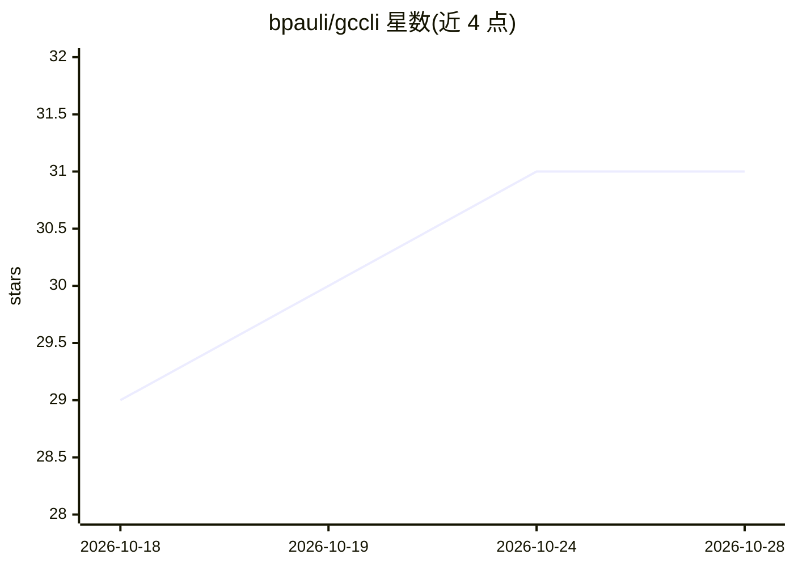

# bpauli/gccli

⭐ 31 · Go · MIT · 推送 2026-10-28 · [GitHub](https://github.com/bpauli/gccli) · 个人维护

**面向 Garmin Connect 的命令行工具，附 AI 助手技能**

用 Go 编写的 Garmin Connect CLI：覆盖活动、健康数据、身体成分、训练计划、设备、装备、目标徽章、营养、社交、高尔夫等命令面，输出 JSON/TSV 供脚本使用；支持多账号、浏览器 SSO 与 headless 登录、OAuth token 自动刷新、OS keyring 凭据存储、429/5xx 重试策略。仓库附带 SKILL.md 格式的 agent 技能，可使 Claude Code、Codex、Hermes、OpenClaw 等 AI 助手以自然语言驱动该 CLI，含自由文本力量训练记录的引导流程。安装途径为 Homebrew 或 Go 源码构建。

## 筛选速览

| 维度 | 判定 | 备注 |
|---|---|---|
| AI 角色 | `ai-enhanced` | 去掉 AI 部分产品仍成立 |
| 许可风险 | `permissive` | MIT |
| 部署形态 | `None` |  |
| 模型依赖 | — | README 未给出锁定关系 |
| 硬件要求 | — | 无带数字的原话,不猜 |
| 安装摩擦 | `low` | 无编译、无系统依赖或容器化 |
| 成熟度 | — | 结构信号不足 |

## 能力要点

- 覆盖 Garmin Connect 活动/健康/训练/设备/装备等完整命令面的 CLI
- JSON/TSV 输出，--json 输出在主版本内保持稳定
- OS keyring 凭据存储、多账号、token 自动刷新与重试策略
- 内置 SKILL.md agent 技能，供 Claude Code/Codex/Hermes/OpenClaw 以自然语言调用

## 适用场景

- 用脚本或命令行批量导出和管理我的 Garmin 健康与运动数据
- 让 AI 助手通过对话查询睡眠、下载跑步记录或记录力量训练
- 在服务器上无浏览器环境访问 Garmin Connect 数据

## 场景标签

 · 领域:健康/运动数据工具

## 证据(README 行号)

> L10: Fast, script-friendly CLI for Garmin Connect. Access activities, health data, body composition, workouts, courses, 
> L34: - **Agent-ready** - ships a bundled agent skill (`skills/gccli/`) that plugs into AI assistants like Claude Code, C

## 星数曲线

2026-10-18 29 → 2026-10-28 31（+2）

---
*卡片 v1 · prompt 1.4 · 生成 2026-10-26 · 置信度 high · 依据 README sha `f51e8c68619c` · [字段定义](../../DATASET.md)*
