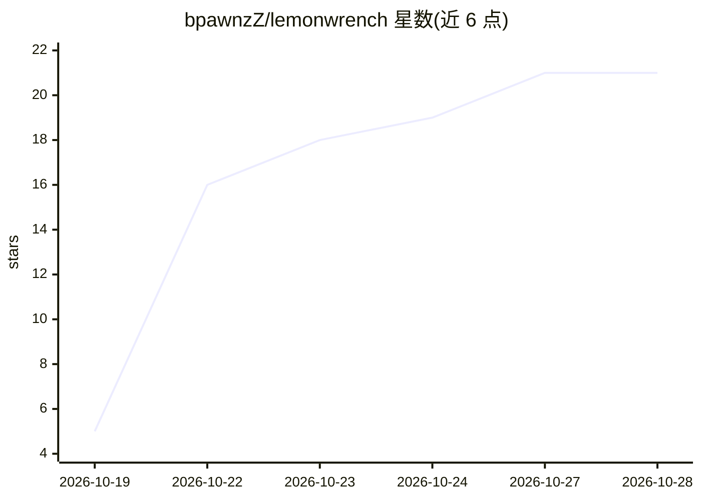

# bpawnzZ/lemonwrench

⭐ 21 · Python · MIT · 推送 2026-10-28 · [GitHub](https://github.com/bpawnzZ/lemonwrench) · 个人维护

**汽车维修 AI agent 技能：从免费 OEM 手册查工序与扭矩**

面向 AI coding agent（Claude Code、Hermes 等）的 SKILL.md 格式技能，配合 stdlib 导航脚本 lemon.py，从免费 OEM 服务手册站点 lemon-manuals.la（约 1 万辆美/加车辆，1960–2025，69 个品牌）抓取维修工序、扭矩表与标注图。机制：先索引车辆链接树（约 5MB 缓存），后续查询为本地 grep 再按需取单页；区分 2025 抓取（LEMON）与 2013 DVD（CHARM）两套数据；执行手册→配件目录→维修工共识的三来源规则并标注信息出处。Python 3.9+、无依赖、无 API key，脚本可独立于 agent 使用。

## 筛选速览

| 维度 | 判定 | 备注 |
|---|---|---|
| AI 角色 | `ai-ecosystem` | LLM/agent 周边工具 |
| 许可风险 | `permissive` | MIT |
| 部署形态 | `None` |  |
| 模型依赖 | — | README 未给出锁定关系 |
| 硬件要求 | — | 无带数字的原话,不猜 |
| 安装摩擦 | `low` | 无编译、无系统依赖或容器化 |
| 成熟度 | — | 结构信号不足 |

## 能力要点

- 覆盖 69 品牌、1960–2025、约 1 万辆美/加车辆的两套手册数据库
- 链接树一次索引后本地 grep 检索，仅抓取命中单页
- 三来源规则（手册/配件目录/维修工共识），来源不一致时如实标注
- 图片下载与 note 命令将图解描述持久化为文本

## 适用场景

- 让 AI agent 查询具体车型的维修工序与扭矩规格
- DIY 车主生成带图解与置信度标注的作业笔记
- 独立使用命令行脚本查询车辆覆盖范围与手册页

## 场景标签

`文档问答` `网页抓取` · 领域:效率与自动化

## 证据(README 行号)

> L3: **A skill for AI coding agents — Claude Code, Hermes, or any harness that reads `SKILL.md`** — that turns a car into
> L5: You drop the folder in, and your agent gets a lookup procedure plus a stdlib script for a free service-manual site. 
> L52: |`SKILL.md`|The agent skill: workflow, answering rules, gotchas, deliverable format|

## 星数曲线

2026-10-19 5 → 2026-10-28 21（+16）

---
*卡片 v1 · prompt 1.4 · 生成 2026-10-28 · 置信度 high · 依据 README sha `2948270a1d83` · [字段定义](../../DATASET.md)*
