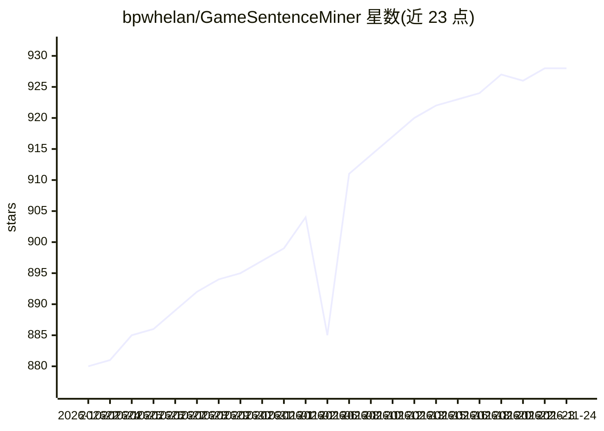

# bpwhelan/GameSentenceMiner

⭐ 927 · Python · GPL-3.0 · 推送 2026-11-23 · [GitHub](https://github.com/bpwhelan/GameSentenceMiner) · [官网](https://docs.gamesentenceminer.com) · 个人维护 · 中文 README

**游戏沉浸式语言学习工具：自动截图录音 OCR 生成 Anki 卡片**

GSM 是一款运行于游戏与 Anki 之间的桌面应用，自动完成音频录制、截图/GIF 抓取与 OCR 文本读取，将游戏对话制作为含音频与截图的闪卡；支持 VAD 语音检测裁剪、历史语句回溯制卡、内置 Texthooker 多行捕获、透明悬浮窗词典查询（Yomitan）与假名标注，以及沉浸统计面板（汉字网格、每日目标）。AI 翻译为可选功能，需用户自带 API key。安装为下载 release 的托管式安装，依赖 Anki 工具与文本来源（钩子工具或内置 OCR）。

## 筛选速览

| 维度 | 判定 | 备注 |
|---|---|---|
| AI 角色 | `ai-enhanced` | 去掉 AI 部分产品仍成立 |
| 许可风险 | `viral` | GPL-3.0 |
| 部署形态 | `None` |  |
| 模型依赖 | — | README 未给出锁定关系 |
| 硬件要求 | — | 无带数字的原话,不猜 |
| 安装摩擦 | `low` | 无编译、无系统依赖或容器化 |
| 成熟度 | — | 结构信号不足 |

## 能力要点

- VAD 音频捕获 + 语句时刻截图/GIF 自动生成 Anki 卡片
- 内置 OwOCR 定制分支读取无文本钩子游戏的屏幕文字，支持自定义捕获区域
- 游戏内透明悬浮窗词典查询与自动假名显示
- 沉浸统计面板：汉字网格、每日目标、挖掘历史管理

## 适用场景

- 玩不支持文本钩子的游戏（如只只狼、MGS）时挖句制卡
- 自动为 Anki 卡片附加游戏原声与截图上下文
- 游戏中悬浮查词并即时生成闪卡，不打断游玩
- 追踪每日沉浸学习量与已见汉字

## 场景标签

`OCR` · 领域:感知与多模态

## 证据(README 行号)

> L27: GSM is an application designed to automate the process of creating flashcards while you play. It sits between your 
> L35: * **AI Translation:** Optional integration to provide sentence translations using your own API key.

## 星数曲线

2026-10-22 880 → 2026-11-24 928（+48）

---
*卡片 v1 · prompt 1.4 · 生成 2026-11-24 · 置信度 mid · 依据 README sha `afb24ec1e4d9` · [字段定义](../../DATASET.md)*
