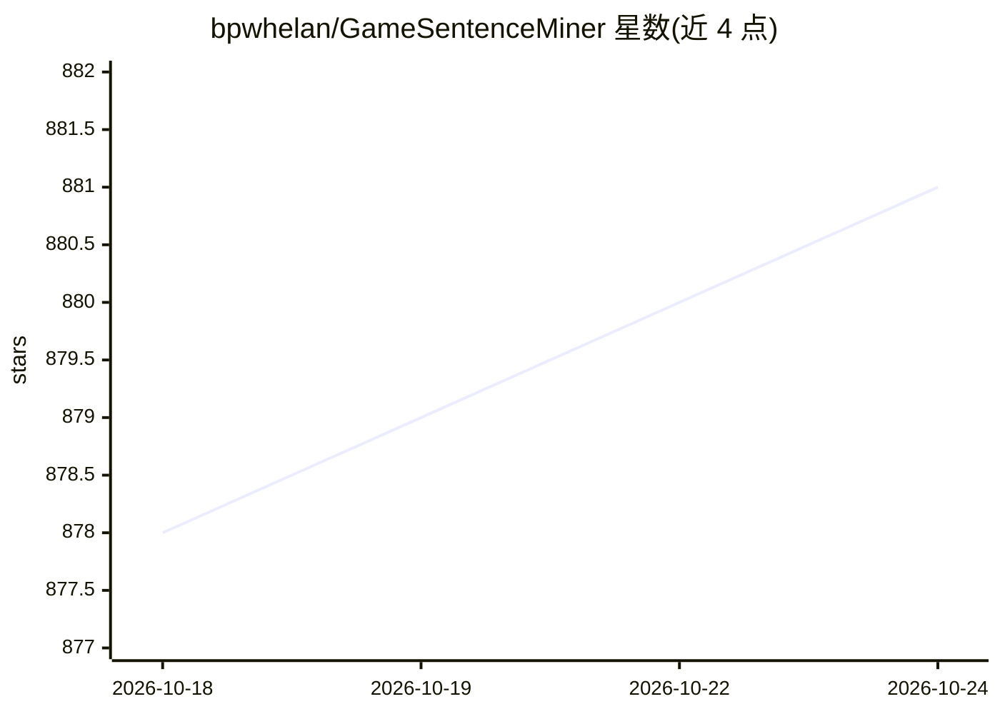

# bpwhelan/GameSentenceMiner

⭐ 885 · Python · GPL-3.0 · 推送 2026-10-23 · [GitHub](https://github.com/bpwhelan/GameSentenceMiner) · [官网](https://docs.gamesentenceminer.com) · 个人维护 · 中文 README

**游戏中自动挖句制 Anki 卡的语言沉浸工具**

面向通过游戏等视觉媒体做语言沉浸学习（日语/中文/韩语等）的桌面应用：位于游戏与 Anki 之间，自动录制语音（VAD 裁剪）、抓取截图/GIF 并通过内置 OCR（OwOCR 定制分支）从屏幕读取文本，自动生成带上下文的 Anki 卡片；另提供 Yomitan 弹词悬浮层、Texthooker 多行捕获、汉字网格统计与可选的 AI 翻译（自带 API key）。需要搭配 Anki 工具与文本源（Agent/Textractor/内置 OCR）使用，通过 GitHub release 下载安装。

## 筛选速览

| 维度 | 判定 | 备注 |
|---|---|---|
| AI 角色 | `ai-enhanced` | 去掉 AI 部分产品仍成立 |
| 许可风险 | `viral` | GPL-3.0 |
| 部署形态 | `None` |  |
| 模型依赖 | — | README 未给出锁定关系 |
| 硬件要求 | — | 无带数字的原话,不猜 |
| 安装摩擦 | `low` | 无编译、无系统依赖或容器化 |
| 成熟度 | — | 结构信号不足 |

## 能力要点

- VAD 语音裁剪 + 截图/GIF 自动附加到 Anki 卡片
- 内置 OwOCR 定制分支，两遍式屏幕 OCR 读取游戏文本
- 游戏内悬浮层词典查询与自动注音显示
- 可选 AI 翻译集成（使用用户自己的 API key）

## 适用场景

- 玩不支持文本 hook 的游戏时用 OCR 挖句子做卡
- 自动给 Anki 卡片配上游戏语音与画面
- 追踪沉浸学习进度与汉字覆盖情况

## 场景标签

`OCR` · 领域:感知与多模态

## 证据(README 行号)

> L27: GSM is an application designed to automate the process of creating flashcards while you play. It sits between your 
> L40: For games that don't have a text hook (Agent/Textractor), GSM uses a custom fork of OwOCR to read text directly fro
> L35: * **AI Translation:** Optional integration to provide sentence translations using your own API key.

## 星数曲线

2026-10-18 878 → 2026-10-24 881（+3）

---
*卡片 v1 · prompt 1.4 · 生成 2026-10-21 · 置信度 high · 依据 README sha `f285c5ccf462` · [字段定义](../../DATASET.md)*
