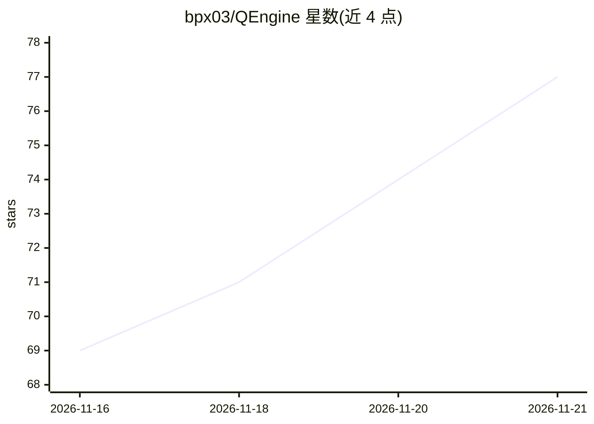

# bpx03/QEngine

⭐ 77 · Cuda · MIT · 推送 2026-11-20 · [GitHub](https://github.com/bpx03/QEngine) · 个人维护

**面向 RTX 30-50 系多卡的 C++/CUDA 本地 LLM 推理引擎**

MIT 许可的本地推理引擎，用 C++/CUDA 共享库加 Python 服务器运行两个模型：Qwen3.8-Flash-Next（512 专家稀疏 MoE，INT4/INT8 混合量化）与 Qwen3.8-27B（INT4），支持 262K 上下文（可选 1M）、图像输入、工具调用与结构化输出，通过 OpenAI 兼容与 Anthropic 兼容 API 对外服务。需 Linux、2-3 张 RTX 3000/4000/5000 系显卡（RTX 3090 调优）与 CUDA 13.1 驱动，Flash-Next 默认配置约需 140 GB 主机内存（可自 64 GB 起）。提供 Docker 镜像与源码构建两种方式，附监控面板与 Prometheus 指标。

## 筛选速览

| 维度 | 判定 | 备注 |
|---|---|---|
| AI 角色 | `ai-ecosystem` | LLM/agent 周边工具 |
| 许可风险 | `permissive` | MIT |
| 部署形态 | `desktop` | 安装包/桌面程序 |
| 模型依赖 | — | README 未给出锁定关系 |
| 硬件要求 | — | 无带数字的原话,不猜 |
| 安装摩擦 | `low` | 无编译、无系统依赖或容器化 |
| 成熟度 | `idea` | |

## 能力要点

- 单服务器同时提供 OpenAI 与 Anthropic 兼容 API
- Flash-Next：512 路由专家稀疏 MoE，262K 上下文（可扩至 1M）
- 4-bit KV 缓存、MTP 投机解码、DFlash2 等量化与加速机制
- 多卡部署方案：2/3/4+ 卡、KV 缓存驻留主机内存等配方

## 适用场景

- 在 2-3 张 RTX 3090/4090/5090 上本地部署 Qwen 模型服务
- 为 Claude Code 等 agent 客户端提供本地推理后端
- 长文档处理与大上下文多会话服务

## 场景标签

`推理引擎` · 领域:训练与推理

## 证据(README 行号)

> L9: QEngine is an open-source (MIT) inference engine for two models on NVIDIA RTX 3000, 4000 and 5000 series cards, with
> L19: One server serves either model through an **OpenAI-compatible** and an **Anthropic-compatible** API (it works with
> L20: agent clients such as Claude Code). The C++/CUDA engines are built as shared libraries; the Python server loads the

## 星数曲线

2026-11-16 69 → 2026-11-21 77（+8）

---
*卡片 v1 · prompt 1.4 · 生成 2026-11-18 · 置信度 mid · 依据 README sha `75c06b1442bc` · [字段定义](../../DATASET.md)*
