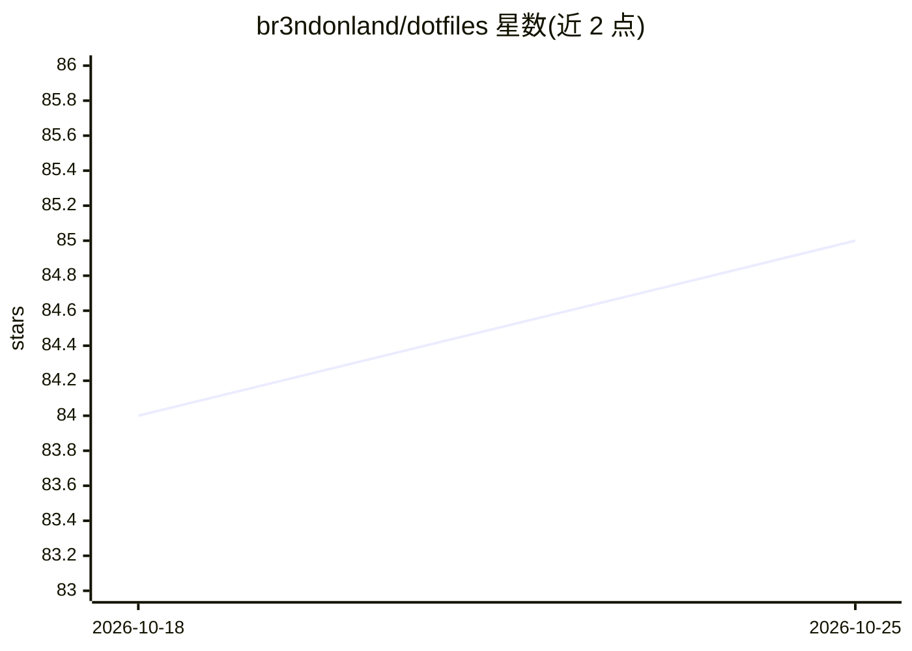

# br3ndonland/dotfiles

⭐ 85 · Starlark · MIT · 推送 2026-10-18 · [GitHub](https://github.com/br3ndonland/dotfiles) · 个人维护

**个人 macOS/Linux 开发环境配置文件集与一键初始化脚本**

Brendon Smith 的 dotfiles 仓库：存放应用配置与设置文件，兼容 Linux 和 macOS。核心是 bootstrap.sh，一个幂等的 shell 脚本，通过环境变量配置 Git 信息后从远端克隆仓库，自动完成 Homebrew 设置、执行 scripts/ 目录脚本并按 Brewfile 批量安装包与 cask 应用。README 另记录硬件清单（Apple Silicon Mac mini）、macOS/Karabiner 键位、mise 工具管理、Git 签名与 shell 配置等；仓库主题标签涉及 claude-code、codex、opencode 等 AI 编码工具，且 Warp 配置中区分 general 与 agent settings。供希望自动化、可抛弃式开发环境的开发者使用；属个人配置，非通用产品。

## 筛选速览

| 维度 | 判定 | 备注 |
|---|---|---|
| AI 角色 | `ai-enhanced` | 去掉 AI 部分产品仍成立 |
| 许可风险 | `permissive` | MIT |
| 部署形态 | `self-host` | docker 或自建部署 |
| 模型依赖 | — | README 未给出锁定关系 |
| 硬件要求 | — | 无带数字的原话,不猜 |
| 安装摩擦 | `low` | 无编译、无系统依赖或容器化 |
| 成熟度 | — | 结构信号不足 |

## 能力要点

- bootstrap.sh 幂等脚本一键初始化 macOS/Linux 开发机
- 通过环境变量配置 Git 信息与仓库来源
- Brewfile 批量管理 Homebrew 包、cask 与 mas 应用
- mise-en-place 统一管理多语言工具版本

## 适用场景

- 新电脑上快速恢复我的开发环境配置
- 用 Git 历史记录配置变更的原因与排障过程
- 批量安装和管理 Homebrew 软件包与应用

## 场景标签

 · 领域:开发环境配置/DevOps

## 证据(README 行号)

> L11: This repo contains dotfiles, which are application configuration and settings files. They frequently begin with a d
> L21: This dotfiles repository is meant to be installed by `bootstrap.sh`.
> L136:  - Why are different directories used for general settings and agent settings?

## 星数曲线

2026-10-18 84 → 2026-10-25 85（+1）

---
*卡片 v1 · prompt 1.4 · 生成 2026-10-24 · 置信度 low · 依据 README sha `e42cdb675346` · [字段定义](../../DATASET.md)*
