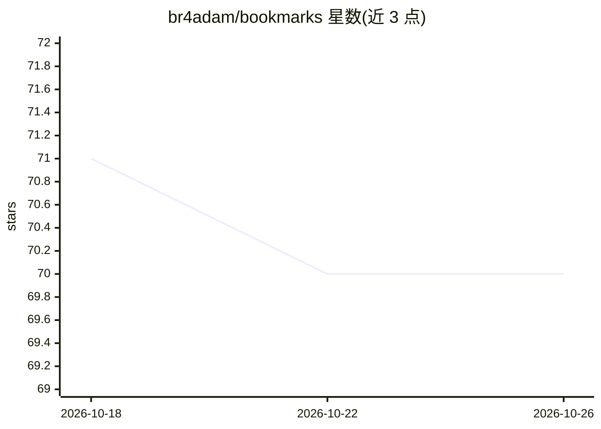

# br4adam/bookmarks

⭐ 70 · TypeScript · MIT · 推送 2026-05-09 · [GitHub](https://github.com/br4adam/bookmarks) · [官网](https://kmarks.boo) · 个人维护

**网页书签管理应用：保存、打标签、命令菜单检索**

基于 React 的 Web 应用，用于保存和组织书签：粘贴 URL 即可保存网站，可通过 AI 生成标签（smart tags）实现分类，并支持按标签过滤与通过命令菜单进行搜索。README 未给出安装/运行命令，也未说明 AI 标签生成所依赖的具体模型或服务。面向需要集中管理常用网站链接的个人用户。

## 筛选速览

| 维度 | 判定 | 备注 |
|---|---|---|
| AI 角色 | `ai-enhanced` | 去掉 AI 部分产品仍成立 |
| 许可风险 | `permissive` | MIT |
| 部署形态 | `None` |  |
| 模型依赖 | — | README 未给出锁定关系 |
| 硬件要求 | — | 无带数字的原话,不猜 |
| 安装摩擦 | `low` | 无编译、无系统依赖或容器化 |
| 成熟度 | — | 结构信号不足 |

## 能力要点

- 粘贴/输入 URL 即时保存书签
- AI 生成智能标签用于分类
- 按标签过滤与命令菜单快速搜索

## 适用场景

- 集中保存和管理常用网站链接
- 用 AI 生成的标签对书签分类
- 通过命令菜单快速检索书签

## 场景标签

`知识库管理` · 领域:知识与检索

## 证据(README 行号)

> L5: A web application designed to save and organize your bookmarks. With this app you can effortlessly manage your favor
> L11: Generate smart tags with AI, making it a breeze to find and access your most treasured pages.

## 星数曲线

2026-10-18 71 → 2026-10-26 70（-1）

---
*卡片 v1 · prompt 1.4 · 生成 2026-10-24 · 置信度 mid · 依据 README sha `4731b479980c` · [字段定义](../../DATASET.md)*
