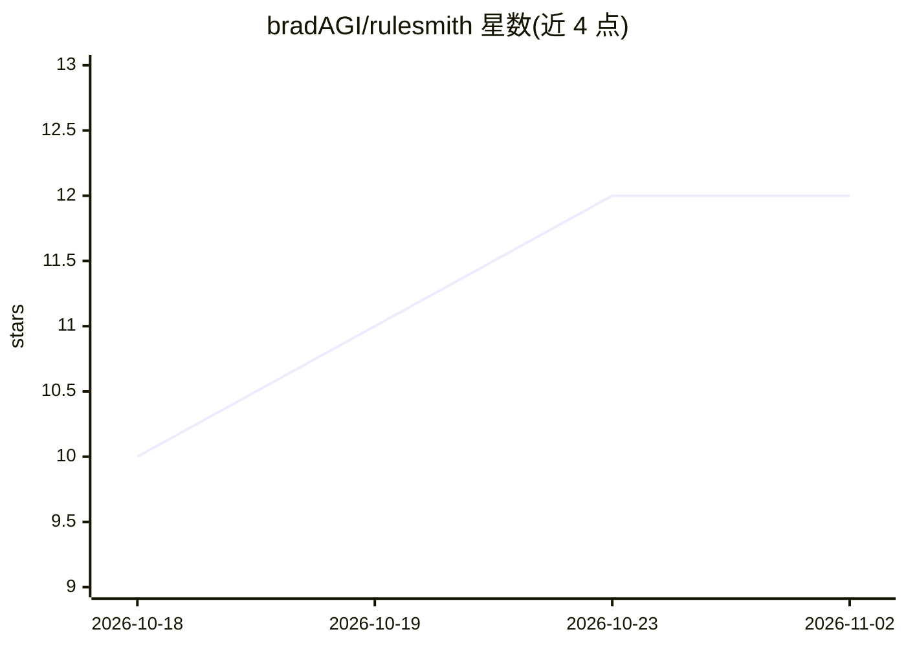

# bradAGI/rulesmith

⭐ 12 · Python · MIT · 推送 2026-10-20 · [GitHub](https://github.com/bradAGI/rulesmith) · [官网](https://pypi.org/project/rulesmith/) · 个人维护

**让 DSPy 搜索可读规则决策图、少数难题交本地/托管 judge 模型的库**

Python 库，基于 DSPy 与 GEPA 搜索生成小型规则程序：对输入字段的廉价检查先裁决简单样本，其余交给本地或托管 judge 模型回答类型化问题，保留得分更高的修订，输出可读、可编辑、可运行、可服务的 rules 文件。README 给出基准结果（含不占优场景）与 TF-IDF 仍更优的案例，另支持将同一搜索用于游戏（Doom 对战）。需要 Python 3.12–3.14、OpenAI 兼容的 judge 与写规则模型。

## 筛选速览

| 维度 | 判定 | 备注 |
|---|---|---|
| AI 角色 | `ai-ecosystem` | LLM/agent 周边工具 |
| 许可风险 | `permissive` | MIT |
| 部署形态 | `library` | 以包/库形式分发 |
| 模型依赖 | local-ok | 支持本地模型 |
| 硬件要求 | — | 无带数字的原话,不猜 |
| 安装摩擦 | `low` | 无编译、无系统依赖或容器化 |
| 成熟度 | — | 结构信号不足 |

## 能力要点

- 字段规则先裁决、judge 模型只处理剩余案例，减少模型调用次数
- GEPA 搜索保留得分更高的规则修订
- 输出可读可编辑可服务的 rules 文件，含置信度与校准
- 同一搜索机制可用于游戏（Doom）决策图

## 适用场景

- 我用标注样本自动生成低成本高准确率的文本分类规则
- 我想让大部分样本走免模型调用规则、仅疑难样本请求 judge
- 我需要可审计可编辑的分类决策图而非黑盒模型

## 场景标签

 · 领域:LLM 基础设施/分类

## 证据(README 行号)

> L5: **rulesmith lets DSPy build decision graphs for you.** Give it a classification
> L7: on the input's fields settle the cases they can, and a local or hosted judge is

## 星数曲线

2026-10-18 10 → 2026-11-02 12（+2）

---
*卡片 v1 · prompt 1.4 · 生成 2026-11-01 · 置信度 high · 依据 README sha `f70611905f73` · [字段定义](../../DATASET.md)*
