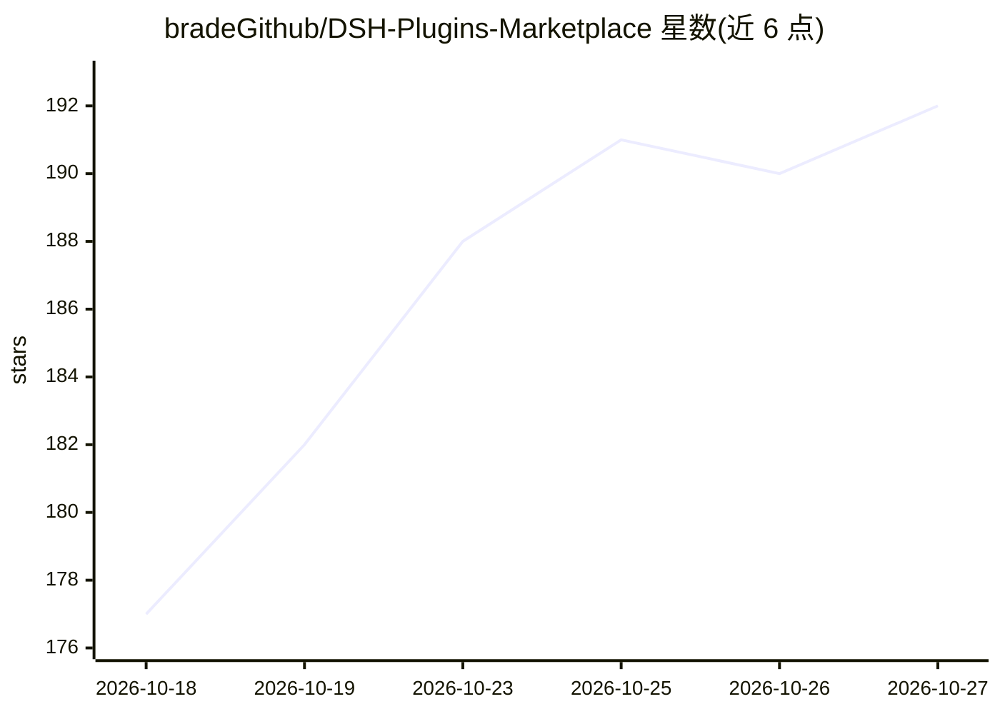

# bradeGithub/DSH-Plugins-Marketplace

⭐ 192 · JavaScript · MIT · 推送 2026-10-26 · [GitHub](https://github.com/bradeGithub/DSH-Plugins-Marketplace) · 组织维护 · 中文 README

**DeepSeek Harness 的插件市场插件：GUI 内浏览/安装/更新 GitHub dsh-plugin 插件**

作为 DeepSeek Harness（DSH）的一个插件，自动索引 GitHub dsh-plugin topic 下的插件（自称 9500+）与 20000+ 通用 Skills，在 DSH Web GUI 设置页以卡片展示，支持一键安装、版本检测与自动更新。CI 每 2 小时增量扫描生成静态索引，多级降级分发减少 GitHub API 消耗。安装形式区分桌面端（粘贴仓库地址）与 Web/CLI（dsh plugin 命令或脚本）。README 列出已知限制：安装端点无用户认证、版本检测仅对含 package.json 的插件生效、第三方插件不作担保。

## 筛选速览

| 维度 | 判定 | 备注 |
|---|---|---|
| AI 角色 | `ai-ecosystem` | LLM/agent 周边工具 |
| 许可风险 | `permissive` | MIT |
| 部署形态 | `None` |  |
| 模型依赖 | locked-api |  |
| 硬件要求 | — | 无带数字的原话,不猜 |
| 安装摩擦 | `low` | 无编译、无系统依赖或容器化 |
| 成熟度 | — | 结构信号不足 |

## 能力要点

- CI 每 2 小时增量扫描 dsh-plugin topic 生成静态索引，多级降级分发
- 自动识别 cordis 插件/SKILL.md/agent 预设/安装脚本四型并完成依赖安装与注册
- 第三方脚本与 npm 生命周期脚本执行前弹窗确认，安装材料仅作环境变量不落盘
- 提供备份/恢复/WebDAV 推拉的 HTTP 接口与 LAN 写操作鉴权

## 适用场景

- 在 DSH Web GUI 里浏览和一键安装 GitHub 上的 dsh-plugin 插件
- 自动检测已装插件版本并更新
- 浏览与安装通用 Skills（20000+）

## 场景标签

 · 领域:AI Agent 工具生态/插件管理

## 证据(README 行号)

> L5: 为 DeepSeek Harness（DSH）打造的插件市场插件：自动索引 GitHub `dsh-plugin` topic 下的全部插件，在 DSH Web GUI 设置页以卡片展示，支持一键安装、版本检测与自动更新，无需命令行
> L39: dsh plugin --profile web install bradeGithub/DSH-Plugins-Marketplace
> L116: - 已安装判定六段管线：安装清单 → 托管目录启发式（`dirOwners`）→ 本体识别 → profile 映射命中（slug/仓库名/`pkg_name` 与 `repository` 双向校验）→ 脚本缓存 → 缓存包名

## 星数曲线

2026-10-18 177 → 2026-10-27 192（+15）

---
*卡片 v1 · prompt 1.4 · 生成 2026-10-23 · 置信度 high · 依据 README sha `3e74e3e82204` · [字段定义](../../DATASET.md)*
