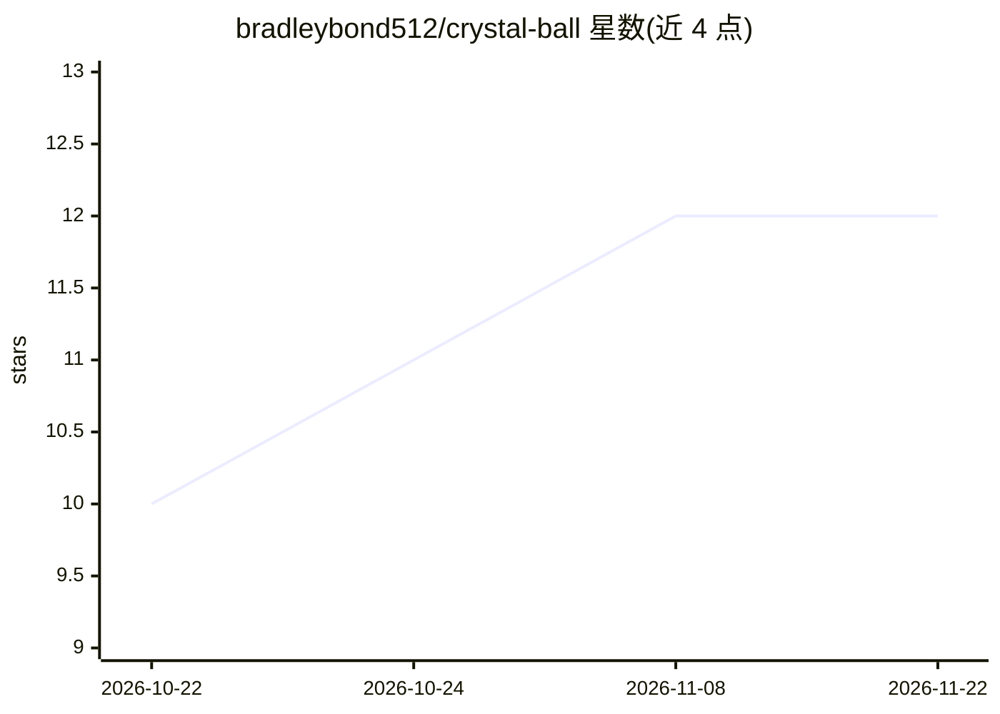

# bradleybond512/crystal-ball

⭐ 12 · TypeScript · NOASSERTION · 推送 2026-11-20 · [GitHub](https://github.com/bradleybond512/crystal-ball) · [官网](https://crystal-ball-observatory.bradleybond512.chatgpt.site/) · 个人维护

**面向 Mac 的本地优先全球情报监控桌面平台**

基于 Tauri 2 的桌面应用，从 ACLED、GDACS、NWS、USGS 等数十个数据源拉取实时信号，通过 2D MapLibre 地图、3D Cesium 地球、面板目录、统一警报收件箱与关联引擎呈现；支持地理围栏、警报分级、情境聚类与自定义规则。算法层为确定性实现（truth scoring、evidence graph、compound risk、forecast calibration），带 600+ 单元测试。LLM 部分为可选：默认走本地 Ollama/LM Studio（→Groq），再回退云端 Claude，生成简报与问答；每日云端调用有预算上限。macOS 为主要平台，Windows/Linux 为实验性构建。

## 筛选速览

| 维度 | 判定 | 备注 |
|---|---|---|
| AI 角色 | `ai-enhanced` | 去掉 AI 部分产品仍成立 |
| 许可风险 | `viral` | NOASSERTION |
| 部署形态 | `None` |  |
| 模型依赖 | local-ok | 支持本地模型 |
| 硬件要求 | — | 无带数字的原话,不猜 |
| 安装摩擦 | `low` | 无编译、无系统依赖或容器化 |
| 成熟度 | `idea` | |

## 能力要点

- 185 个实时面板与多源聚合（ACLED/GDACS/NWS/USGS/CISA/FRED 等）
- 本地优先 LLM 路由：Ollama/LM Studio → Groq，回退云端 Claude，含每日云端预算
- 确定性算法智能层：truth scoring、证据图、复合风险、预测校准（约 158 项专项测试）
- 统一警报系统：分级打分、时空聚类、地理围栏、MCP server 供 Claude Code 调用 /sitrep

## 适用场景

- 在 Mac 上集中监控全球灾害、冲突、网络威胁与市场信号
- 为家庭/办公地点设置地理围栏并获得本地推送警报
- 通过 Claude Code 的 /sitrep 获取聚合情报简报
- 用本地 Ollama 生成简报以控制云端调用成本

## 场景标签

 · 领域:桌面情报/数据聚合工具

## 证据(README 行号)

> L5: A private intelligence desk for your Mac. Live signals from around the globe, explained in plain language.
> L15: macOS is the primary desktop platform. Windows and Linux builds are experimental. Local Ollama inference can run on
> L112: **Local-first LLM with daily budget**: all generation routes through `/api/intel-generate` (Ollama / LM Studio → G

## 星数曲线

2026-10-22 10 → 2026-11-22 12（+2）

---
*卡片 v1 · prompt 1.4 · 生成 2026-11-18 · 置信度 high · 依据 README sha `927239c6a3a3` · [字段定义](../../DATASET.md)*
