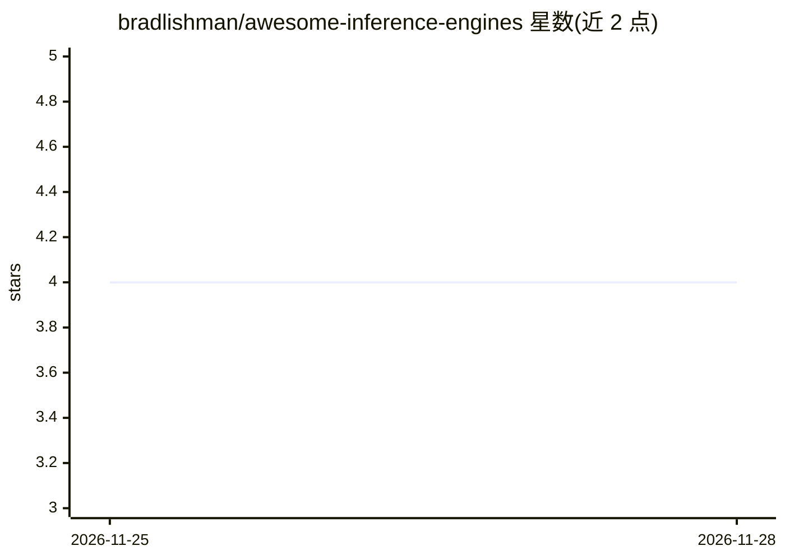

# bradlishman/awesome-inference-engines

⭐ 4 · Python · CC0-1.0 · 推送 2026-11-26 · [GitHub](https://github.com/bradlishman/awesome-inference-engines) · 个人维护

**LLM 推理引擎的精选技术参考清单，按硬件与负载检索**

收录从本地便携运行时到专用 GPU 内核与分布式 serving 的大模型推理引擎清单，核心关注模型计算发生的位置与方式：硬件、模型家族、量化、KV/循环状态管理、内存分层、批处理与 serving 架构。明确区分独立推理引擎与模型管理器/API 代理，后者单列一节。按硬件与负载场景（Apple Silicon、消费级 GPU、MoE 内存溢出、边缘设备等）给出起点，并提示以兼容矩阵与流式基准探针核对上游声明。

## 筛选速览

| 维度 | 判定 | 备注 |
|---|---|---|
| AI 角色 | `ai-knowledge` | 知识聚合/清单类 |
| 许可风险 | `viral` | CC0-1.0 |
| 部署形态 | `None` |  |
| 模型依赖 | — | README 未给出锁定关系 |
| 硬件要求 | — | 无带数字的原话,不猜 |
| 安装摩擦 | `medium` | 含编译或系统依赖之一 |
| 成熟度 | — | 结构信号不足 |

## 能力要点

- 按硬件与负载场景（Apple Silicon/消费级 GPU/MoE/边缘）组织的选型路径
- 区分独立推理引擎与模型管理器/API 代理，分节收录
- 提供上游声明来源的兼容矩阵与可复现的流式基准探针

## 适用场景

- 在特定硬件（如 Apple Silicon 或消费级 NVIDIA GPU）上挑选本地推理引擎
- 为多用户生产 serving 场景筛选高吞吐引擎
- 了解大 MoE 模型内存分层与卸载方案生态

## 场景标签

`精选清单` · 领域:学习与行业

## 证据(README 行号)

> L3: Inference engines and execution systems for large language models, from portable local runtimes to highly specialize
> L7: This is a curated technical reference, not a leaderboard. Performance claims should be evaluated against matching mo

## 星数曲线

2026-11-25 4 → 2026-11-28 4（+0）

---
*卡片 v1 · prompt 1.4 · 生成 2026-11-24 · 置信度 high · 依据 README sha `19987655e615` · [字段定义](../../DATASET.md)*
