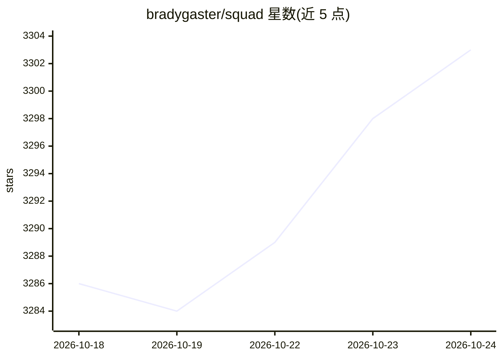

# bradygaster/squad

⭐ 3,303 · TypeScript · MIT · 推送 2026-10-23 · [GitHub](https://github.com/bradygaster/squad) · [官网](https://bradygaster.github.io/squad/) · 个人维护

**基于 GitHub Copilot 的人主导多 AI 代理团队 CLI 工具**

面向开发者的命令行工具，通过 GitHub Copilot 组建持久化的 AI 代理团队（前端、后端、测试、lead 等角色），团队成员以文件形式存在于仓库中，跨会话保留、共享决策。提供 17 个命令：初始化、升级、watch 模式（Ralph 轮询 GitHub Issues 自动分派 Copilot 代理执行，含四级错误恢复与状态后端）、导出/导入、插件市场等。强调人类保留审批与决策权，代理各自独立上下文运行。安装途径含 npm、Homebrew、WinGet 与独立脚本，另提供 .NET NuGet 包将 Squad 团队注册为 Agent Framework 代理。旧版交互式 shell 已标记弃用。

## 筛选速览

| 维度 | 判定 | 备注 |
|---|---|---|
| AI 角色 | `ai-ecosystem` | LLM/agent 周边工具 |
| 许可风险 | `permissive` | MIT |
| 部署形态 | `library` | 以包/库形式分发 |
| 模型依赖 | — | README 未给出锁定关系 |
| 硬件要求 | — | 无带数字的原话,不猜 |
| 安装摩擦 | `medium` | 含编译或系统依赖之一 |
| 成熟度 | — | 结构信号不足 |

## 能力要点

- AI 团队成员以文件形式持久化在仓库中，跨会话保留并共享决策
- Ralph watch 模式轮询 Issues，由代理自行选择任务并分派 Copilot 执行
- 17 个 CLI 命令，覆盖初始化、升级、分诊、导出导入与插件市场
- 提供 npm/Homebrew/WinGet/安装脚本四种安装途径与 .NET NuGet 包

## 适用场景

- 在项目中组建专业分工的 AI 开发团队并行处理任务
- 自动轮询 GitHub Issues 并分派代理处理、人工审批收尾
- 需要保留人类 oversight 的代理协作开发流程

## 场景标签

`多智能体` `Agent 框架` · 领域:Agent 开发

## 证据(README 行号)

> L13: Squad gives you a human-directed AI development team through GitHub Copilot. Describe what you're building. Get a t
> L74: copilot --agent squad --yolo

## 星数曲线

2026-10-18 3,286 → 2026-10-24 3,303（+17）

---
*卡片 v1 · prompt 1.4 · 生成 2026-10-21 · 置信度 high · 依据 README sha `9cd041333a18` · [字段定义](../../DATASET.md)*
