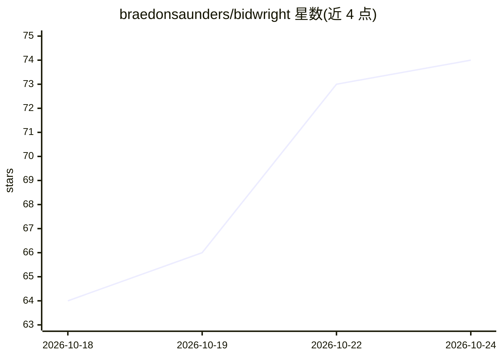

# braedonsaunders/bidwright

⭐ 74 · TypeScript · AGPL-3.0 · 推送 2026-10-23 · [GitHub](https://github.com/braedonsaunders/bidwright) · [官网](https://demo.bidwright.app) · 个人维护

**面向建筑投标的 AI 代理估价平台：从标书接收到报价交付**

自托管的建设工程估价平台，覆盖标书包接收解析、PDF/图纸 2D 算量、BIM/CAD 3D 模型算量、参数化组件库、费率/人工/负担定价引擎、进度计划、知识库与品牌化报价 PDF 生成。核心机制是贯穿全流程的 AI 代理：多模型供应商（Anthropic/OpenAI/OpenRouter/Gemini/LM Studio）、Ollama 本地嵌入加 pgvector 混合检索、150+ 工具、MCP 服务器与 Claude Code/Codex 会话，可自动做报价审查并给出证据关联发现。本地运行仅需 Docker Desktop，通过脚本安装器启动；AGPL-3.0 许可。

## 筛选速览

| 维度 | 判定 | 备注 |
|---|---|---|
| AI 角色 | `ai-native` | 本体是模型或模型工具 |
| 许可风险 | `viral` | AGPL-3.0 |
| 部署形态 | `library` | 以包/库形式分发 |
| 模型依赖 | local-ok | 支持本地模型 |
| 硬件要求 | — | 无带数字的原话,不猜 |
| 安装摩擦 | `low` | 无编译、无系统依赖或容器化 |
| 成熟度 | `idea` | |

## 能力要点

- 2D 图纸与 3D BIM 模型算量并回链工作表行项
- 多供应商 LLM 适配（Anthropic/OpenAI/OpenRouter/Gemini/LM Studio）+ Ollama 本地嵌入 + pgvector 混合检索
- 代理驱动的报价审查：覆盖/缺口/风险/竞争力分析并关联文档证据
- MCP 服务器与 Claude Code/Codex 隔离会话，150+ 工具

## 适用场景

- 建筑承包商/估价师从标书包到报价 PDF 的一体化流程
- 让 AI 代理读取图纸与规范并审查估价的覆盖与风险
- 自托管企业级多租户估价知识库与定价体系

## 场景标签

`文档解析` `RAG` · 领域:知识与检索

## 证据(README 行号)

> L5:  The estimating platform that runs the whole bid — intake, knowledge, takeoff, pricing, scheduling, review, and quot
> L13: Bidwright keeps the LLM provider adapter in `packages/agent`, while estimating actions live in the API, MCP server,
> L15: Multi-provider out of the box: **Anthropic, OpenAI, OpenRouter, Gemini, LM Studio**. Local embeddings via **Ollama*

## 星数曲线

2026-10-18 64 → 2026-10-24 74（+10）

---
*卡片 v1 · prompt 1.4 · 生成 2026-10-24 · 置信度 mid · 依据 README sha `dea7c755f1fe` · [字段定义](../../DATASET.md)*
