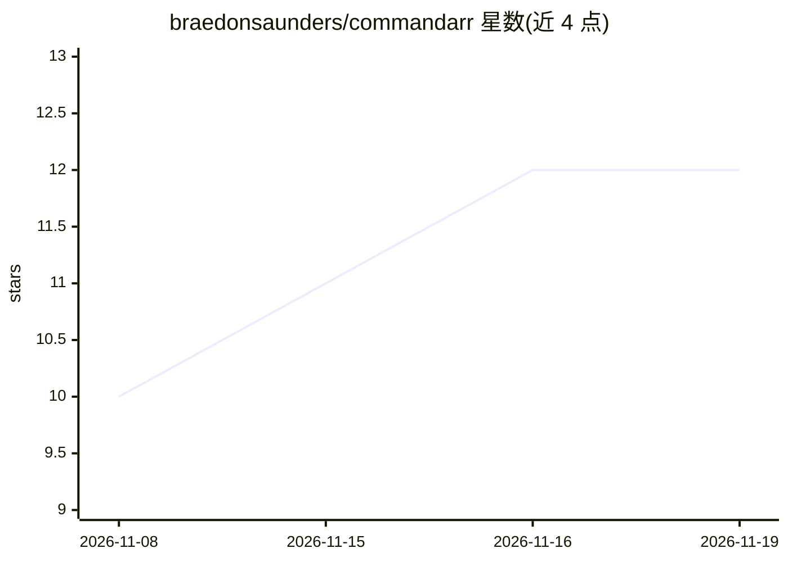

# braedonsaunders/commandarr

⭐ 12 · TypeScript · 推送 2026-04-28 · [GitHub](https://github.com/braedonsaunders/commandarr) · 个人维护

**面向 Plex/*arr 自托管媒体栈的 LLM agent 统一控制台**

自托管的 LLM agent，通过 Telegram/Discord/网页仪表盘以自然语言查询与操作 Plex/Jellyfin/Emby、Radarr/Sonarr 等 *arr 工具、下载客户端及网络设施，内置 37+ 集成、140+ 工具；支持自然语言定时自动化、按描述即时生成仪表盘组件（HTML/CSS/JS），并能从描述或 API 文档生成新集成。要求 Docker 与 LLM API key，可用 Ollama/LM Studio 全本地运行；数据经 SQLite 存储，无需外部数据库。

## 筛选速览

| 维度 | 判定 | 备注 |
|---|---|---|
| AI 角色 | `ai-native` | 本体是模型或模型工具 |
| 许可风险 | `none` | — |
| 部署形态 | `self-host` | docker 或自建部署 |
| 模型依赖 | local-ok | 支持本地模型 |
| 硬件要求 | — | 无带数字的原话,不猜 |
| 安装摩擦 | `low` | 无编译、无系统依赖或容器化 |
| 成熟度 | — | 结构信号不足 |

## 能力要点

- 37+ 集成、140+ 工具的跨服务自然语言查询与操作
- 描述即生成仪表盘组件（无模板，支持拖放与自动刷新）
- 自然语言自动化定时任务（无需 cron 语法）
- 多 LLM 提供商按优先级自动降级，可全本地运行

## 适用场景

- 用一个聊天入口管理 Plex、Sonarr、qBittorrent 等整套自托管服务
- 每天定时通过 Telegram 收到下载摘要
- 按描述搭建自己的媒体库仪表盘组件
- 让 agent 自动编写尚不存在的服务集成

## 场景标签

`AI 助手` `工作流自动化` · 领域:效率与自动化

## 证据(README 行号)

> L5:  Commandarr is an AI agent that talks to your entire Plex/Jellyfin/Emby + *arr ecosystem.
> L60: - An LLM API key — OpenRouter (recommended), OpenAI, Anthropic, Google Gemini, or run fully local with Ollama / LM 
> L68: Chat from the web dashboard, Telegram, or Discord. The agent has access to 100+ tools across all your services and 

## 星数曲线

2026-11-08 10 → 2026-11-19 12（+2）

---
*卡片 v1 · prompt 1.4 · 生成 2026-11-18 · 置信度 high · 依据 README sha `23a7ae167bae` · [字段定义](../../DATASET.md)*
