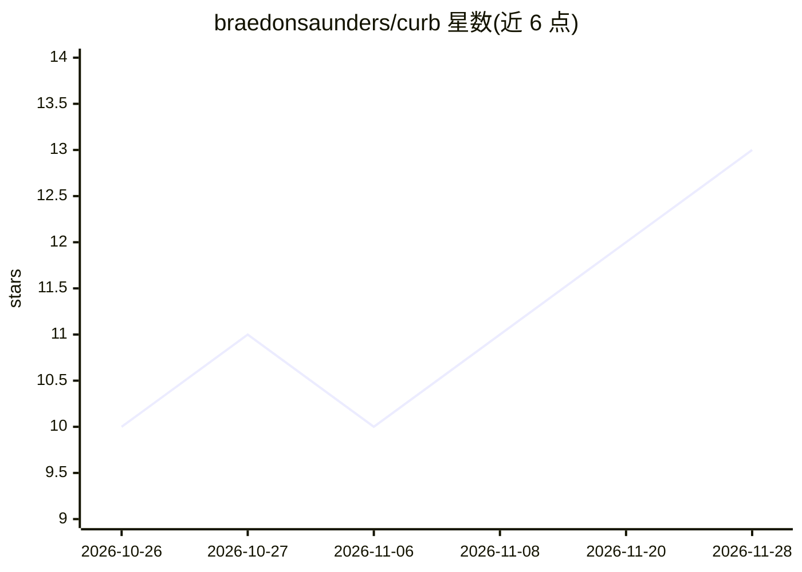

# braedonsaunders/curb

⭐ 13 · TypeScript · MIT · 推送 2026-04-18 · [GitHub](https://github.com/braedonsaunders/curb) · 个人维护

**为网站销售者发现弱站点、生成替代站并附证外联的工具**

面向向本地商家出售网站服务的自由职业者与代理机构：通过 Google Places 发现商家，用 Playwright 截图与 AI 审核评估其现有网站，标记薄弱或缺失站点，生成定制的静态替代网站并在本地预览，再将带预览链接和定价的首次外联邮件发给商家。管线数据存于本地 SQLite，生成站点与截图保留在本机。需 Node.js 20+、Google Places API key 及至少一家 AI 服务商的凭证。

## 筛选速览

| 维度 | 判定 | 备注 |
|---|---|---|
| AI 角色 | `ai-native` | 本体是模型或模型工具 |
| 许可风险 | `permissive` | MIT |
| 部署形态 | `library` | 以包/库形式分发 |
| 模型依赖 | locked-api |  |
| 硬件要求 | — | 无带数字的原话,不猜 |
| 安装摩擦 | `low` | 无编译、无系统依赖或容器化 |
| 成熟度 | — | 结构信号不足 |

## 能力要点

- 通过 Google Places 发现并富化本地商家记录
- Playwright 截图加 AI 审核评估现有网站并标记薄弱站点
- 生成定制静态替代站并在本地应用内预览
- 模型无关：支持 Anthropic、OpenAI、Google、OpenRouter

## 适用场景

- 为本地商家生成成品网站作为首次外联的证明
- 按地区与类别批量发现缺站或弱站的潜在客户
- 在 SQLite 管线板中跟踪从发现到成交的流程

## 场景标签

 · 领域:销售/市场工具

## 证据(README 行号)

> L37: - Audits an existing website with screenshots and AI review
> L39: - Generates a tailored static replacement site
> L53: - Model-agnostic. Use Anthropic, OpenAI, Google, or OpenRouter.

## 星数曲线

2026-10-26 10 → 2026-11-28 13（+3）

---
*卡片 v1 · prompt 1.4 · 生成 2026-11-18 · 置信度 high · 依据 README sha `4c36a3bc1a46` · [字段定义](../../DATASET.md)*
