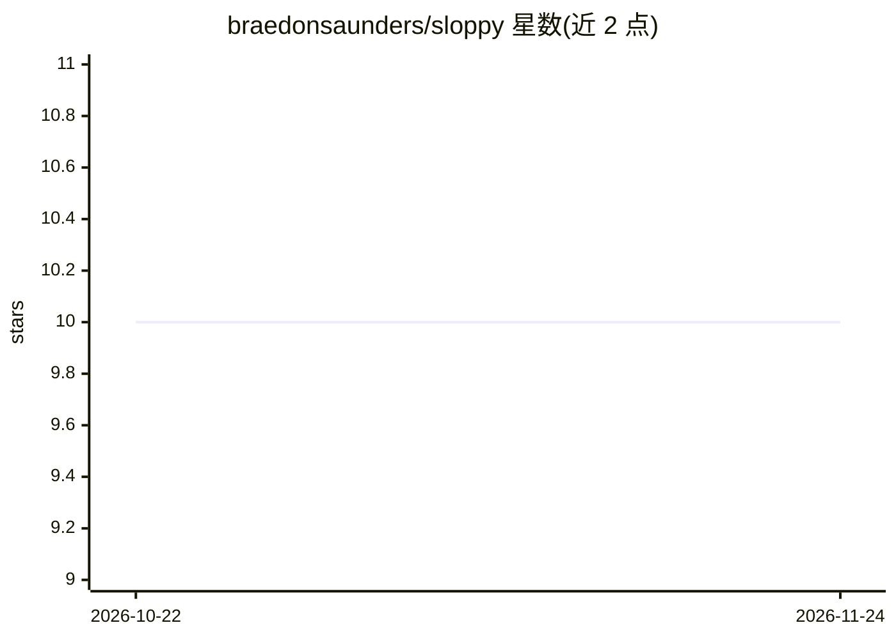

# braedonsaunders/sloppy

⭐ 10 · TypeScript · MIT · 推送 2026-03-21 · [GitHub](https://github.com/braedonsaunders/sloppy) · 个人维护

**给开发者的 PR 代码质量扫描与多轮 AI 自动修复 GitHub Action**

以 GitHub Action 形式运行的代码质量工具：扫描模式默认走 GitHub Models 免费额度，无需 API key，对每个 PR 输出 0-100 分评分、issue 评论、历史记录与 HTML dashboard，内置三层管线（本地 regex、AI 扫描、SHA256 缓存）。修复模式需自带 API key，通过 Claude Code CLI 或 OpenAI Codex CLI 进行多轮扫描-修复-重扫循环，按 issue 生成原子提交并用检测到的测试命令验证、失败则回滚。提供预算上限、并行 agent（git worktrees）、profile 与插件机制。

## 筛选速览

| 维度 | 判定 | 备注 |
|---|---|---|
| AI 角色 | `ai-native` | 本体是模型或模型工具 |
| 许可风险 | `permissive` | MIT |
| 部署形态 | `self-host` | docker 或自建部署 |
| 模型依赖 | locked-api |  |
| 硬件要求 | — | 无带数字的原话,不猜 |
| 安装摩擦 | `low` | 无编译、无系统依赖或容器化 |
| 成熟度 | — | 结构信号不足 |

## 能力要点

- 多轮扫描-修复-重扫循环，直到无新问题或触及预算上限
- 扫描模式使用 GitHub Models 免费额度，无需 API key 与配置
- 每个修复一个原子提交，自动检测测试命令并回滚失败修复
- 评分公式按 KLOC 与严重级权重计算，支持 fail-below CI 门禁

## 适用场景

- 每个 PR 自动给出代码质量评分与问题分解
- 开启修复模式让 AI 批量修 security/bugs/dead-code 等八类问题
- 用 fail-below 阈值把评分作为 CI 合并门禁

## 场景标签

`代码审查` `编码 Agent` · 领域:编码与开发

## 证据(README 行号)

> L3:  AI code cleanup that doesn't stop after one pass.
> L54: Uses the **GitHub Models free tier** to analyze your code. Every GitHub user has access.
> L109: Bring your own API key. Sloppy uses **Claude Code CLI** or **OpenAI Codex CLI** to find and fix issues, then opens

## 星数曲线

2026-10-22 10 → 2026-11-24 10（+0）

---
*卡片 v1 · prompt 1.4 · 生成 2026-11-19 · 置信度 mid · 依据 README sha `473b0b089879` · [字段定义](../../DATASET.md)*
