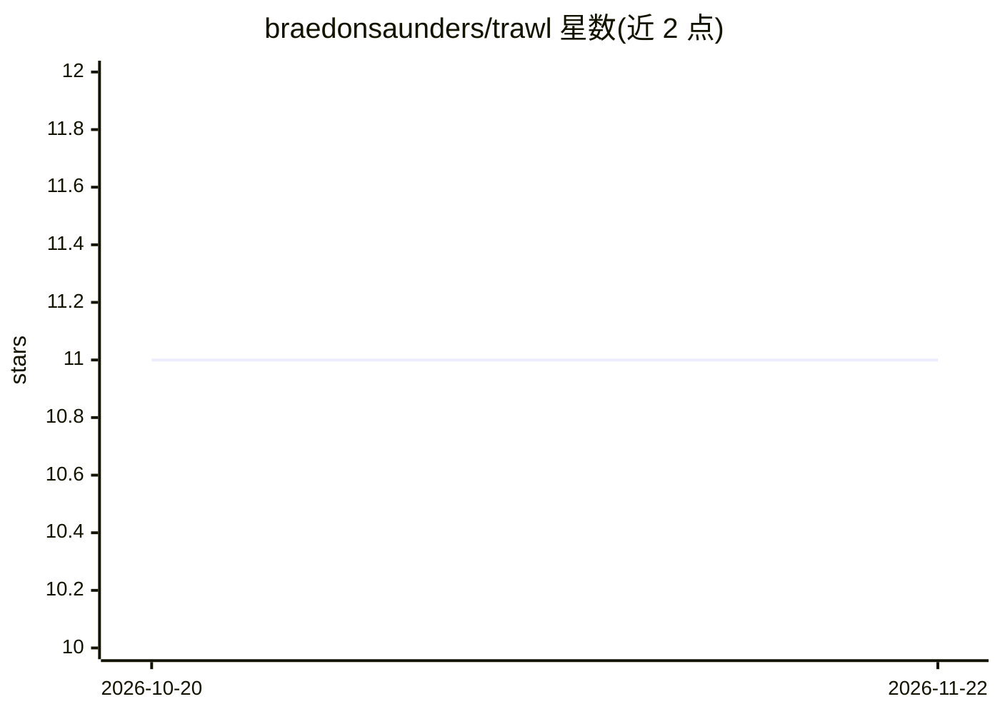

# braedonsaunders/trawl

⭐ 11 · TypeScript · MIT · 推送 2026-03-15 · [GitHub](https://github.com/braedonsaunders/trawl) · 个人维护

**给 B2B 销售者的本地线索挖掘与个性化冷邮件生成桌面应用**

以 Electron 桌面应用形式发布的 B2B 销售线索工具：按市场与地域发现商户，用 Playwright 抓取目标网站内容并由 LLM 提取情报，依据用户公司画像对线索评分，生成个性化邮件草稿供人工审核发送。数据存于本地 SQLite，无需托管 CRM；核心循环为发现→富化→评分→草稿排队。提供 pnpm 本地开发路径与桌面安装器构建脚本，打包产物含 Next.js UI、Node 运行时与 Playwright Chromium。

## 筛选速览

| 维度 | 判定 | 备注 |
|---|---|---|
| AI 角色 | `ai-native` | 本体是模型或模型工具 |
| 许可风险 | `permissive` | MIT |
| 部署形态 | `library` | 以包/库形式分发 |
| 模型依赖 | — | README 未给出锁定关系 |
| 硬件要求 | — | 无带数字的原话,不猜 |
| 安装摩擦 | `low` | 无编译、无系统依赖或容器化 |
| 成熟度 | — | 结构信号不足 |

## 能力要点

- Playwright + LLM 读取目标网站正文做线索情报提取
- 按公司画像对线索进行契合度评分
- 本地优先：SQLite 存储、Electron 桌面分发
- AI 生成个性化草稿，人工介入处理热线索

## 适用场景

- 为本地细分市场批量发现并研究潜在客户
- 按自身公司画像筛选高契合度线索
- 生成个性化冷邮件草稿供人工审核发送

## 场景标签

`浏览器自动化` `网页抓取` `AI 写作` · 领域:效率与自动化

## 证据(README 行号)

> L16: It is a desktop command center for B2B prospecting: discover businesses in a target market, crawl their sites, extr
> L24: - Research-backed prospecting. Trawl uses Playwright and LLMs to read the actual website, not just metadata.

## 星数曲线

2026-10-20 11 → 2026-11-22 11（+0）

---
*卡片 v1 · prompt 1.4 · 生成 2026-11-18 · 置信度 high · 依据 README sha `12f3ecd42faf` · [字段定义](../../DATASET.md)*
