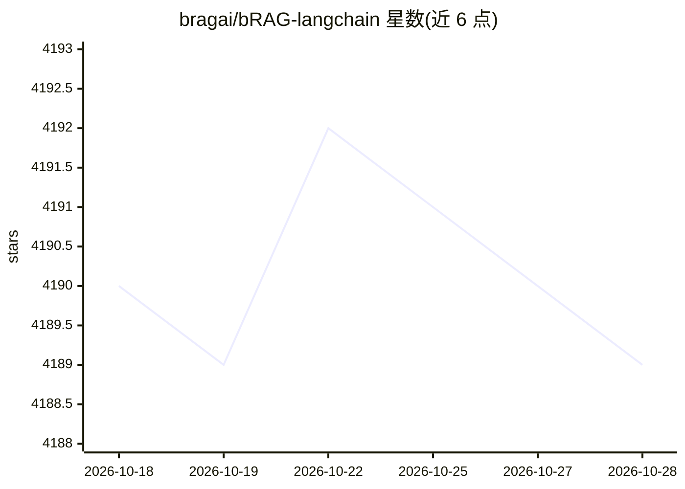

# bragai/bRAG-langchain

⭐ 4,189 · Jupyter Notebook · NOASSERTION · 推送 2026-10-18 · [GitHub](https://github.com/bragai/bRAG-langchain) · [官网](https://bragai.dev) · 个人维护

**RAG 教学笔记本合集：从入门到高级检索的实现指南**

面向学习者的 LangChain RAG 实践教程仓库：5 个 Jupyter 笔记本依次覆盖 RAG 基础搭建（OpenAI 嵌入、ChromaDB/Pinecone 向量库）、多查询检索、逻辑/语义路由与结构化查询、多表示索引（ColBERT、RAPTOR、MultiVectorRetriever）、RAG-Fusion 与 Cohere 重排、CRAG/Self-RAG 等高级检索。另提供 full_basic_rag.ipynb 作为可定制的 RAG 聊天机器人样板代码。运行需 Python 3.11.11 虚拟环境、pip 依赖与 OPENAI_API_KEY 等环境变量。

## 筛选速览

| 维度 | 判定 | 备注 |
|---|---|---|
| AI 角色 | `ai-knowledge` | 知识聚合/清单类 |
| 许可风险 | `none` | NOASSERTION |
| 部署形态 | `library` | 以包/库形式分发 |
| 模型依赖 | — | README 未给出锁定关系 |
| 硬件要求 | — | 无带数字的原话,不猜 |
| 安装摩擦 | `low` | 无编译、无系统依赖或容器化 |
| 成熟度 | — | 结构信号不足 |

## 能力要点

- 5 个递进式笔记本覆盖从基础 RAG 到高级检索重排
- full_basic_rag.ipynb 提供可定制的 RAG 聊天机器人样板
- 涵盖多查询、路由、多表示索引、RAG-Fusion、Cohere 重排、CRAG/Self-RAG 等技术

## 适用场景

- 系统学习 RAG 从基础到高级的实现方法
- 以样板代码快速启动一个 RAG 聊天机器人
- 实验多查询、路由与重排等检索优化技术

## 场景标签

`RAG` `教程课程` · 领域:知识与检索

## 证据(README 行号)

> L7: This repository contains a comprehensive exploration of Retrieval-Augmented Generation (RAG) for various application
> L14: If you want to jump straight into it, check out the file `full_basic_rag.ipynb` -> this file will give you a boiler
> L163: #### 5. Run the Notebooks

## 星数曲线

2026-10-18 4,190 → 2026-10-28 4,189（-1）

---
*卡片 v1 · prompt 1.4 · 生成 2026-10-21 · 置信度 high · 依据 README sha `3d496c019c79` · [字段定义](../../DATASET.md)*
