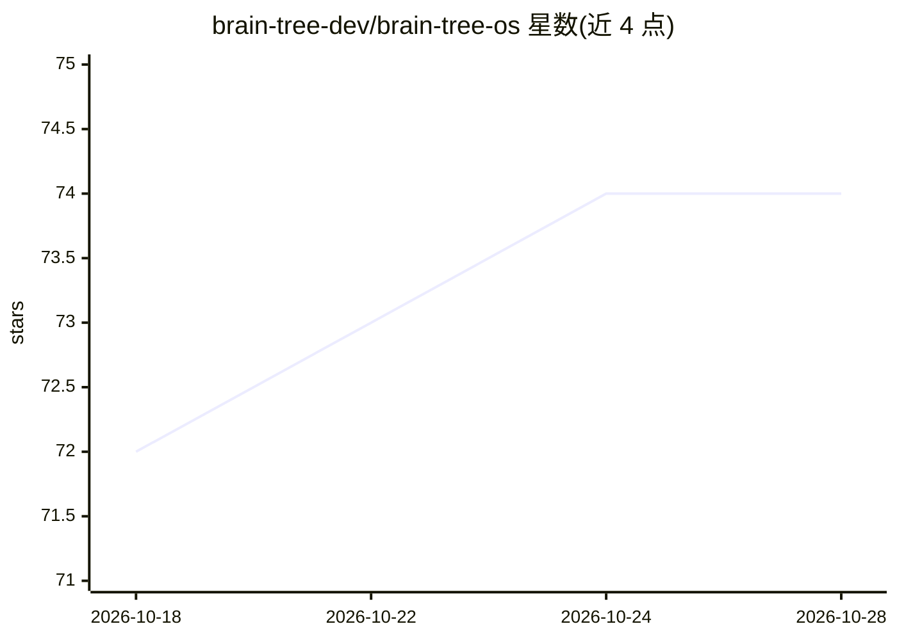

# brain-tree-dev/brain-tree-os

⭐ 74 · TypeScript · MIT · 推送 2026-06-21 · [GitHub](https://github.com/brain-tree-dev/brain-tree-os) · [官网](https://brain-tree.ai) · 组织维护

**给 AI agent 建本地持久知识库的浏览器大脑查看器与项目管理系统**

本地优先的 AI agent 项目管理系统：一条 npx 命令启动 Next.js 网页查看器，通过 /init-braintree 向导在 Claude Code 中生成 25-40 个文件的知识库（部门结构、执行计划、agent 人设、交接文档），并以 8 个斜杠命令驱动会话循环（resume/wrap-up 等）。Wikilink 构成知识图谱，chokidar 监听文件变更经 WebSocket 实时刷新 D3.js 图视图。数据全部存于本地文件系统，无数据库；斜杠命令专为 Claude Code 设计，大脑格式本身兼容任意可读写文件的 AI 工具。另有云版本 brain-tree.ai。需要 Node.js 20+ 与 Claude Code。

## 筛选速览

| 维度 | 判定 | 备注 |
|---|---|---|
| AI 角色 | `ai-ecosystem` | LLM/agent 周边工具 |
| 许可风险 | `permissive` | MIT |
| 部署形态 | `library` | 以包/库形式分发 |
| 模型依赖 | locked-api |  |
| 硬件要求 | — | 无带数字的原话,不猜 |
| 安装摩擦 | `low` | 无编译、无系统依赖或容器化 |
| 成熟度 | — | 结构信号不足 |

## 能力要点

- 8 个 Claude Code 斜杠命令构成 init/resume/wrap-up 会话循环
- 浏览器三栏视图：文件树 + D3.js 知识图谱 + 执行计划，WebSocket 实时更新
- 向导生成 25-40 个定制文件（部门/执行计划/agent 人设/交接文档）
- 纯本地文件系统存储，零网络请求、无遥测

## 适用场景

- 让 AI 编码助手跨会话保留项目上下文与待办状态
- 在浏览器中可视化浏览项目的知识图谱与执行进度
- 管理需要长期连续推进的.side project 或团队项目结构

## 场景标签

`Agent 记忆` `知识库管理` `知识图谱` · 领域:Agent 开发

## 证据(README 行号)

> L7: A local-first project management system designed for AI agents. One command creates a structured knowledge base with
> L112: BrainTree installs 8 slash commands into Claude Code. These are the core of the workflow.
> L316: **Do I need Claude Code?**

## 星数曲线

2026-10-18 72 → 2026-10-28 74（+2）

---
*卡片 v1 · prompt 1.4 · 生成 2026-10-24 · 置信度 high · 依据 README sha `6871c810d138` · [字段定义](../../DATASET.md)*
