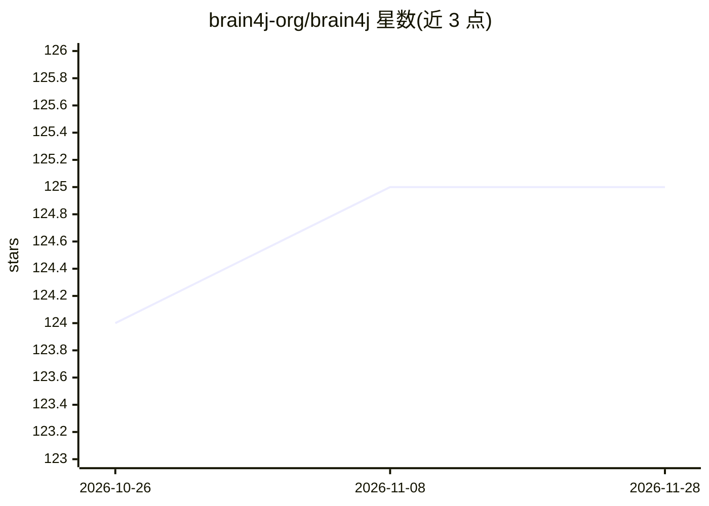

# brain4j-org/brain4j

⭐ 125 · Java · Apache-2.0 · 推送 2026-11-06 · [GitHub](https://github.com/brain4j-org/brain4j) · [官网](https://brain4j.org) · 组织维护

**Java 深度学习框架：用纯 Java 训练与运行神经网络**

Brain4J 是面向 Java 的开源深度学习框架，定位轻量与高性能，支持 CPU 与 GPU 运行，供开发者在纯 Java 环境中实现机器学习方案。要求 Java 22 及以上版本，通过 Maven Central 及官方仓库以 Gradle 依赖引入，文档另设站点，GitHub wiki 仅含 2.0 旧文档且已标注弃用，采用 Apache-2.0 许可。

## 筛选速览

| 维度 | 判定 | 备注 |
|---|---|---|
| AI 角色 | `ai-native` | 本体是模型或模型工具 |
| 许可风险 | `permissive` | Apache-2.0 |
| 部署形态 | `None` |  |
| 模型依赖 | — | README 未给出锁定关系 |
| 硬件要求 | — | 无带数字的原话,不猜 |
| 安装摩擦 | `medium` | 含编译或系统依赖之一 |
| 成熟度 | — | 结构信号不足 |

## 能力要点

- 面向 Java 的轻量深度学习框架，支持 CPU/GPU
- 通过 Maven Central 与官方仓库获取依赖
- 要求 Java 22 或更新版本

## 适用场景

- 在纯 Java 项目中构建和训练神经网络
- 在 JVM 环境下部署轻量机器学习方案

## 场景标签

`模型训练` `推理引擎` · 领域:训练与推理

## 证据(README 行号)

> L10: Brain4J is a lightweight, performant & open-source deep learning framework for Java.
> L14: Designed with portability and speed in mind, it's optimized for high performance, and it's ideal for those looking 
> L15: to implement efficient and portable machine learning solutions in pure Java.

## 星数曲线

2026-10-26 124 → 2026-11-28 125（+1）

---
*卡片 v1 · prompt 1.4 · 生成 2026-11-28 · 置信度 high · 依据 README sha `17b8ce19e5e7` · [字段定义](../../DATASET.md)*
