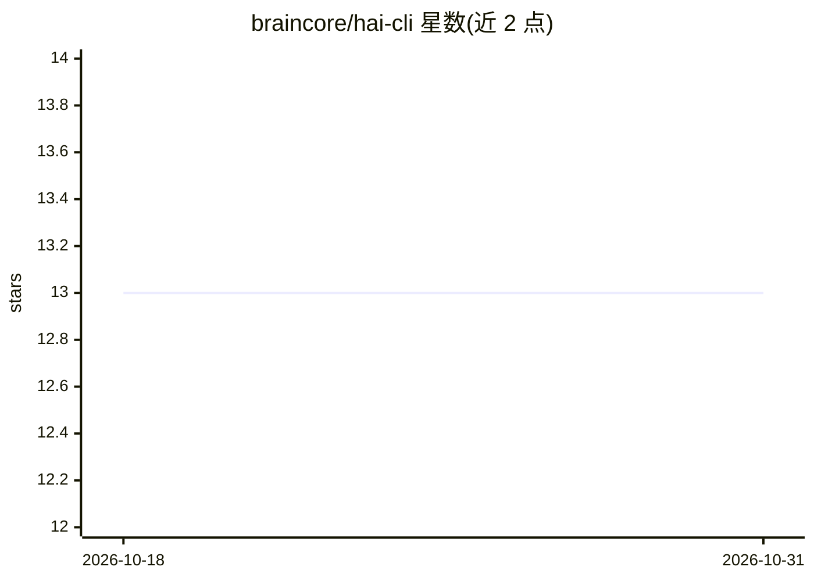

# braincore/hai-cli

⭐ 13 · Rust · NOASSERTION · 推送 2026-10-30 · [GitHub](https://github.com/braincore/hai-cli) · [官网](https://braincore.github.io/hai-cli/) · 个人维护

**面向黑客/开发者的 LLM 交互 REPL 命令行工具**

Rust 编写的单一二进制 CLI 工具 hai，提供 REPL 会话界面，支持在单个会话中接入 OpenAI、Anthropic、DeepSeek、Google、xAI 及本地 llama.cpp/Ollama 等多家模型。功能包括：加载图像/代码/URL 到会话、MCP 服务器连接、agentic 模式、shell/Python/HTML 等内嵌工具、云端 assets 键值存储与邮件通知、任务仓库共享 prompt。支持 Linux 与 macOS，Windows 标注需测试。宣称启动 30ms、压缩后小于 9MB。

## 筛选速览

| 维度 | 判定 | 备注 |
|---|---|---|
| AI 角色 | `ai-ecosystem` | LLM/agent 周边工具 |
| 许可风险 | `none` | NOASSERTION |
| 部署形态 | `library` | 以包/库形式分发 |
| 模型依赖 | local-ok | 支持本地模型 |
| 硬件要求 | — | 无带数字的原话,不猜 |
| 安装摩擦 | `medium` | 含编译或系统依赖之一 |
| 成熟度 | `idea` | |

## 能力要点

- 单一会话中混用多家云模型与本地 llama.cpp/Ollama
- 内嵌 !sh/!py/!pyuv/!html 等工具，可让 LLM 运行本机程序
- 支持 MCP 服务器连接与 agentic 模式
- 云端 assets 存储支持选择性端到端加密与版本修订

## 适用场景

- 在终端里直接与多家 LLM 对话并混合使用
- 让 AI 辅助执行代码审查、日历管理等任务
- 在服务器或 SBC 等轻量环境运行 LLM 会话工具

## 场景标签

`聊天机器人` `AI 助手` `代码审查` · 领域:编码与开发

## 证据(README 行号)

> L8: A CLI (`hai`) with a REPL for hackers using LLMs.
> L25: - 🤖 Supports AIs from OpenAI, Anthropic, DeepSeek, Google, xAI, and
> L26:  llama.cpp/Ollama (local) all in a single conversation.

## 星数曲线

2026-10-18 13 → 2026-10-31 13（+0）

---
*卡片 v1 · prompt 1.4 · 生成 2026-10-31 · 置信度 high · 依据 README sha `628a507661a4` · [字段定义](../../DATASET.md)*
