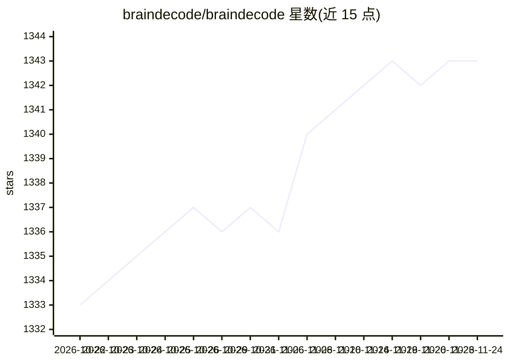

# braindecode/braindecode

⭐ 1,343 · Python · BSD-3-Clause · 推送 2026-11-23 · [GitHub](https://github.com/braindecode/braindecode) · [官网](https://braindecode.org/) · 组织维护

**面向神经科学家的 EEG/ECoG/MEG 深度学习解码工具箱**

开源 Python 工具箱，用深度学习模型解码原始电生理脑信号，覆盖 EEG、ECoG 和 MEG。内置数据集获取器、数据预处理与可视化工具，以及多个深度学习架构实现和数据增强方法。面向想使用深度学习的神经科学家与想处理神经生理数据的深度学习研究者。安装需先安装 PyTorch；如需从 MOABB 下载 EEG 数据集可另行安装 moabb。主体采用 BSD-3-Clause 许可，部分组件采用 CC BY-NC 4.0 等其他许可。

## 筛选速览

| 维度 | 判定 | 备注 |
|---|---|---|
| AI 角色 | `ai-native` | 本体是模型或模型工具 |
| 许可风险 | `permissive` | BSD-3-Clause |
| 部署形态 | `library` | 以包/库形式分发 |
| 模型依赖 | — | README 未给出锁定关系 |
| 硬件要求 | — | 无带数字的原话,不猜 |
| 安装摩擦 | `low` | 无编译、无系统依赖或容器化 |
| 成熟度 | — | 结构信号不足 |

## 能力要点

- 提供 EEG/ECoG/MEG 数据集获取、预处理与可视化工具
- 内置多个深度学习架构实现与数据增强方法
- 提供在线文档（stable 与 dev 版本）
- 提供 Zenodo DOI 引用入口与 BibTeX 条目

## 适用场景

- 对 EEG 信号做深度学习解码分析
- 处理 ECoG 或 MEG 神经生理数据
- 复现脑机接口相关的深度学习研究

## 场景标签

`科研工具` · 领域:学习与行业

## 证据(README 行号)

> L41: Braindecode is an open-source Python toolbox for decoding raw electrophysiological brain
> L43: visualization tools, as well as implementations of several deep learning architectures
> L46: For neuroscientists who want to work with deep learning and deep learning researchers

## 星数曲线

2026-10-22 1,333 → 2026-11-24 1,343（+10）

---
*卡片 v1 · prompt 1.4 · 生成 2026-11-23 · 置信度 high · 依据 README sha `ce507a9dddd5` · [字段定义](../../DATASET.md)*
