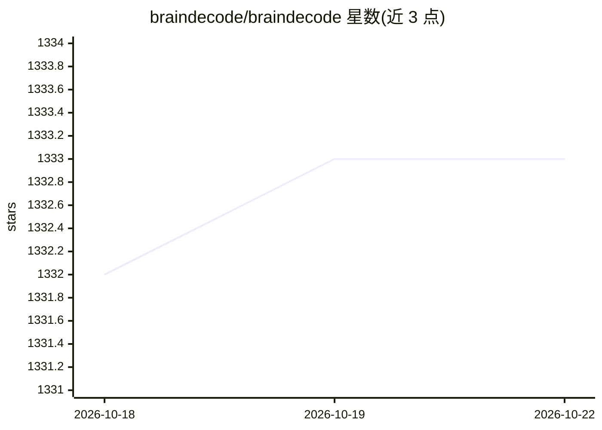

# braindecode/braindecode

⭐ 1,333 · Python · BSD-3-Clause · 推送 2026-10-21 · [GitHub](https://github.com/braindecode/braindecode) · [官网](https://braindecode.org/) · 组织维护

**用深度学习解码 EEG/ECoG/MEG 脑电信号的 Python 工具箱**

开源 Python 工具箱，面向原始电生理脑信号的深度学习解码：内置数据集获取器、预处理与可视化工具、多种深度学习架构实现及数据增强方法，覆盖 EEG、ECoG 与 MEG 分析。目标用户为想使用深度学习的神经科学研究者，以及想处理神经生理数据的深度学习研究者。安装需先装 PyTorch，再 pip 安装；配套 MOABB 可选用于下载 EEG 数据集。BSD-3-Clause 许可，部分组件另有许可，文档在线提供。

## 筛选速览

| 维度 | 判定 | 备注 |
|---|---|---|
| AI 角色 | `ai-native` | 本体是模型或模型工具 |
| 许可风险 | `permissive` | BSD-3-Clause |
| 部署形态 | `library` | 以包/库形式分发 |
| 模型依赖 | — | README 未给出锁定关系 |
| 硬件要求 | — | 无带数字的原话,不猜 |
| 安装摩擦 | `low` | 无编译、无系统依赖或容器化 |
| 成熟度 | — | 结构信号不足 |

## 能力要点

- 提供 EEG/ECoG/MEG 数据集获取、预处理与可视化工具
- 实现多种深度学习架构与数据增强方法
- 基于 PyTorch，pip 安装
- 可选配合 MOABB 下载 EEG 数据集

## 适用场景

- 对 EEG/MEG 脑电数据做深度学习解码分析
- 神经科学研究中复用已有的脑信号深度学习模型
- 快速获取与预处理公开脑电数据集并训练模型

## 场景标签

`科研工具` · 领域:学习与行业

## 证据(README 行号)

> L41: Braindecode is an open-source Python toolbox for decoding raw electrophysiological brain
> L43: visualization tools, as well as implementations of several deep learning architectures
> L46: For neuroscientists who want to work with deep learning and deep learning researchers

## 星数曲线

2026-10-18 1,332 → 2026-10-22 1,333（+1）

---
*卡片 v1 · prompt 1.4 · 生成 2026-10-21 · 置信度 high · 依据 README sha `205b996057a8` · [字段定义](../../DATASET.md)*
