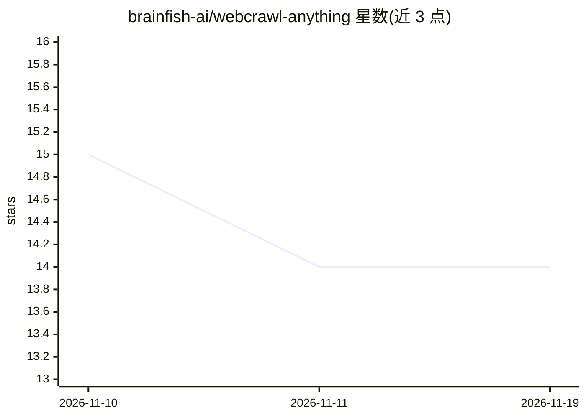

# brainfish-ai/webcrawl-anything

⭐ 14 · TypeScript · MIT · 推送 2026-11-17 · [GitHub](https://github.com/brainfish-ai/webcrawl-anything) · [官网](https://webcrawl.app) · 组织维护

**给 AI agent 的本地零 key 网页抓取/搜索/监控工具（MCP+CLI）**

面向 AI 编程代理的网页数据获取工具：以 MCP 服务器、Agent Skills（SKILL.md）与 CLI 三种形式提供，支持搜索、抓取、站点地图、爬取与定时监控，目标覆盖网站/SPA、PDF/Office、YouTube、GitHub、ArXiv、购物、航班酒店、房产与 CVE。本地运行无需 API key，使用 impit TLS 伪装与本地 Chrome，内置 BM25+语义排序与各垂直提取器；可选切换到 webcrawl.app 云端。通过 npx 安装，与 Claude Code、Cursor、Codex、Gemini、Windsurf 配合使用。

## 筛选速览

| 维度 | 判定 | 备注 |
|---|---|---|
| AI 角色 | `ai-ecosystem` | LLM/agent 周边工具 |
| 许可风险 | `permissive` | MIT |
| 部署形态 | `library` | 以包/库形式分发 |
| 模型依赖 | — | README 未给出锁定关系 |
| 硬件要求 | — | 无带数字的原话,不猜 |
| 安装摩擦 | `low` | 无编译、无系统依赖或容器化 |
| 成熟度 | — | 结构信号不足 |

## 能力要点

- 本地零 API key 运行（impit TLS 伪装 + 本地 Chrome）
- 10 类目标插件（web/pdf-office/youtube/github/arxiv/cve 等）输出 Markdown 与结构化数据
- 提供 8 个 Agent Skills，含价格监控、岗位情报、RAG 语料构建等
- 同一 TypeScript 引擎本地与 webcrawl.app 云端共享，可一键切换

## 适用场景

- 让 Claude Code/Cursor 等 agent 直接抓取网页、PDF、YouTube 转成 Markdown
- 监控商品价格、票务或房产挂牌变动并推送提醒
- 从文档站点构建 RAG 语料与 llms.txt 索引
- 查询 CVE 记录并核对项目依赖

## 场景标签

`网页抓取` `RAG` · 领域:效率与自动化

## 证据(README 行号)

> L7:  Search, scrape, map, crawl and monitor any website, SPA, PDF, YouTube video, GitHub repo, ArXiv paper, product page
> L10:  MCP Server
> L36: To also register the `@webcrawl/mcp` server, so your agent can call the crawl, search and monitor tools directly:

## 星数曲线

2026-11-10 15 → 2026-11-19 14（-1）

---
*卡片 v1 · prompt 1.4 · 生成 2026-11-18 · 置信度 mid · 依据 README sha `8c4eedbe430b` · [字段定义](../../DATASET.md)*
