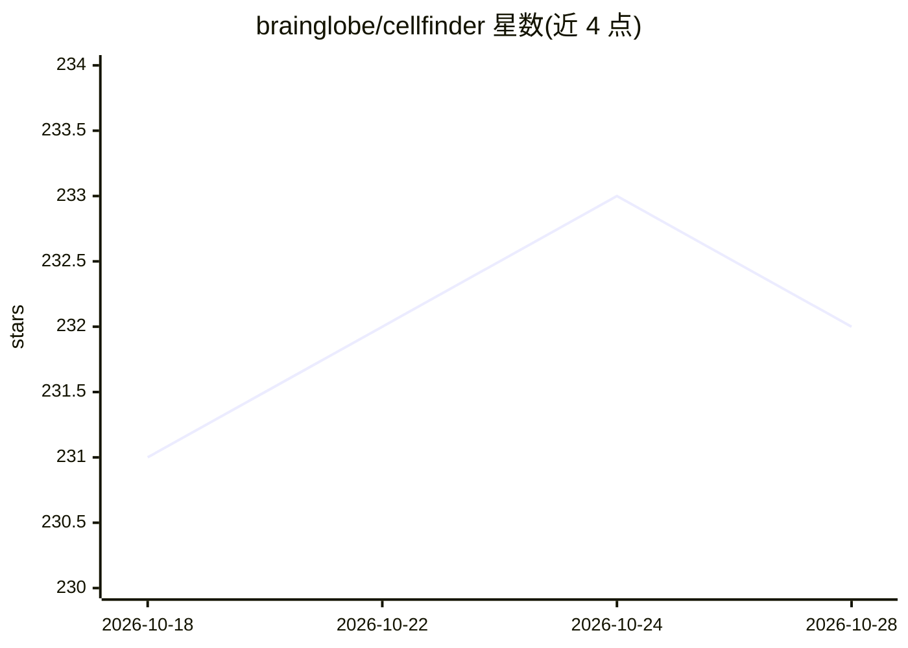

# brainglobe/cellfinder

⭐ 232 · Python · BSD-3-Clause · 推送 2026-10-23 · [GitHub](https://github.com/brainglobe/cellfinder) · [官网](https://brainglobe.info/documentation/cellfinder/index.html) · 组织维护

**科研用户在大体积 3D 显微图像中自动检测细胞**

面向神经科学显微成像（如双光子/光片整脑体积）的自动化 3D 细胞检测软件，基于深度学习算法（PLOS Computational Biology 2021 论文）。提供三种使用方式：brainmapper 命令行工具（集成 brainreg 实现检测与分类）、napari 图形界面插件、以及供自定义工作流集成的 Python API。推荐通过 pip 安装 BrainGlobe 1 或 brainglobe-workflows 获取，也可单独 pip install cellfinder（需 >=1.0.0，旧版结构不兼容）。

## 筛选速览

| 维度 | 判定 | 备注 |
|---|---|---|
| AI 角色 | `ai-native` | 本体是模型或模型工具 |
| 许可风险 | `permissive` | BSD-3-Clause |
| 部署形态 | `library` | 以包/库形式分发 |
| 模型依赖 | — | README 未给出锁定关系 |
| 硬件要求 | — | 无带数字的原话,不猜 |
| 安装摩擦 | `low` | 无编译、无系统依赖或容器化 |
| 成熟度 | — | 结构信号不足 |

## 能力要点

- 深度学习算法自动检测大体积 3D 图像中的细胞
- 提供 CLI（brainmapper）、napari 插件、Python API 三种交互方式
- brainmapper 集成 brainreg 做自动细胞检测与分类
- 配套发表论文可引用（PLOS Computational Biology）

## 适用场景

- 我在整鼠脑双光子/光片显微数据中自动检测细胞
- 我想在 napari 里图形化地做细胞检测
- 我想把细胞检测嵌入自己的 Python 分析流程

## 场景标签

`科研工具` `目标检测` · 领域:学习与行业

## 证据(README 行号)

> L18: cellfinder is software for automated 3D cell detection in very large 3D images (e.g., serial two-photon or lightshe
> L24: - There is a command-line interface called brainmapper that integrates with `brainreg` for automated cell detection

## 星数曲线

2026-10-18 231 → 2026-10-28 232（+1）

---
*卡片 v1 · prompt 1.4 · 生成 2026-10-22 · 置信度 high · 依据 README sha `a3d931160721` · [字段定义](../../DATASET.md)*
