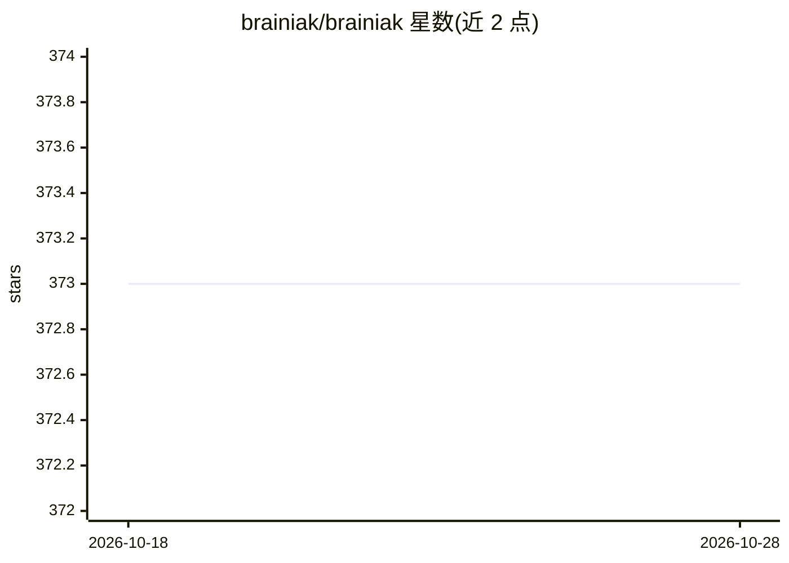

# brainiak/brainiak

⭐ 373 · Python · Apache-2.0 · 推送 2026-10-24 · [GitHub](https://github.com/brainiak/brainiak) · [官网](http://brainiak.org) · 组织维护

**面向神经科学的 fMRI 分析 Python 模块包**

BrainIAK（Brain Imaging Analysis Kit）是用于神经科学、以功能磁共振成像（fMRI）分析为核心的 Python 模块包，包含 SRM 等功能对齐方法及机器学习分析工具，支持 MPI 分布式执行。最初由 Intel 与普林斯顿神经科学研究所合作创建。通过 PyPI wheel（Linux/macOS/Windows）、Conda 包（附带安装 MPI）分发，另提供含 Jupyter Notebook 的 Docker 镜像（不支持 MPI 执行），仓库内附使用示例 notebook，文档见 brainiak.org/docs。

## 筛选速览

| 维度 | 判定 | 备注 |
|---|---|---|
| AI 角色 | `ai-native` | 本体是模型或模型工具 |
| 许可风险 | `permissive` | Apache-2.0 |
| 部署形态 | `self-host` | docker 或自建部署 |
| 模型依赖 | — | README 未给出锁定关系 |
| 硬件要求 | — | 无带数字的原话,不猜 |
| 安装摩擦 | `low` | 无编译、无系统依赖或容器化 |
| 成熟度 | — | 结构信号不足 |

## 能力要点

- 面向 fMRI 分析的 Python 模块包，聚焦神经科学
- 支持 MPI 分布式执行（Conda 安装会附带 MPI）
- PyPI wheel 覆盖 Linux/macOS/Windows
- 提供内置 Jupyter 的 Docker 镜像与示例 notebook

## 适用场景

- 对 fMRI 数据做功能对齐（如 SRM）等分析
- 神经科学研究中运行机器学习分析流程
- 借助 Docker 快速试用示例 notebook

## 场景标签

`科研工具` · 领域:学习与行业

## 证据(README 行号)

> L14: The Brain Imaging Analysis Kit is a package of Python modules useful for
> L15: neuroscience, primarily focused on functional Magnetic Resonance Imaging (fMRI)

## 星数曲线

2026-10-18 373 → 2026-10-28 373（+0）

---
*卡片 v1 · prompt 1.4 · 生成 2026-10-21 · 置信度 high · 依据 README sha `f0116693d807` · [字段定义](../../DATASET.md)*
