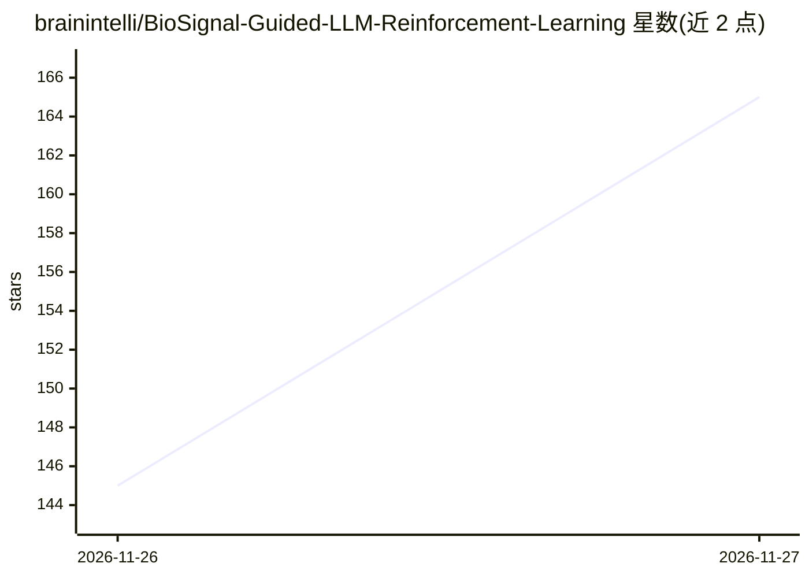

# brainintelli/BioSignal-Guided-LLM-Reinforcement-Learning

⭐ 165 · Python · MIT · 推送 2026-11-24 · [GitHub](https://github.com/brainintelli/BioSignal-Guided-LLM-Reinforcement-Learning) · 组织维护 · 中文 README

**类器官神经信号作为 LLM 智能体策略输入的生存游戏实验研究**

一项可复现的研究项目：将类器官微电极阵列（MEA）离线神经记录转换为每秒四个信号特征（发放率、通道激活比例、时间集中度、跨通道熵），输入冻结的 Qwen 语言模型与价值网络，用 PPO 训练策略适配器，在 Godot 生存游戏中对照 intact/shuffled/all-zero 等输入方案做配对评估。仓库提供论文预印本、训练轨迹、96 个 checkpoint、182 个 H5 原始电生理文件的网盘分发与 SHA-256 校验，以及本地复现分析命令。结论部分报告多数比较区间跨零。

## 筛选速览

| 维度 | 判定 | 备注 |
|---|---|---|
| AI 角色 | `ai-knowledge` | 知识聚合/清单类 |
| 许可风险 | `permissive` | MIT |
| 部署形态 | `None` |  |
| 模型依赖 | — | README 未给出锁定关系 |
| 硬件要求 | — | 无带数字的原话,不猜 |
| 安装摩擦 | `low` | 无编译、无系统依赖或容器化 |
| 成熟度 | — | 结构信号不足 |

## 能力要点

- MEA 电生理信号四特征校准后注入 LLM 提示与价值网络
- 96 个冻结 checkpoint、18,432 局配对评估数据与审计记录公开
- python -m src.reproduce 离线复现配对结果并生成输入哈希
- 182 个原始 H5 电生理文件经网盘共享并提供 SHA-256 校验

## 适用场景

- 复现论文中生物信号引导的探索与生存对照实验
- 查看每个游戏决策对应的轨迹、更新与评估回执
- 研究可变时长动作下探索度量的时钟与终点选择

## 场景标签

`强化学习` · 领域:训练与推理

## 证据(README 行号)

> L1: Biosignal-Guided Reinforcement Learning for LLM Agents
> L5: **Paper**　*Language Model Exploration and Survival Behavior Under Offline Replay of Organoid Neural Signals*
> L61: From the repository root, with Python 3.12:

## 星数曲线

2026-11-26 145 → 2026-11-27 165（+20）

---
*卡片 v1 · prompt 1.4 · 生成 2026-11-26 · 置信度 high · 依据 README sha `86fbcf8cec61` · [字段定义](../../DATASET.md)*
