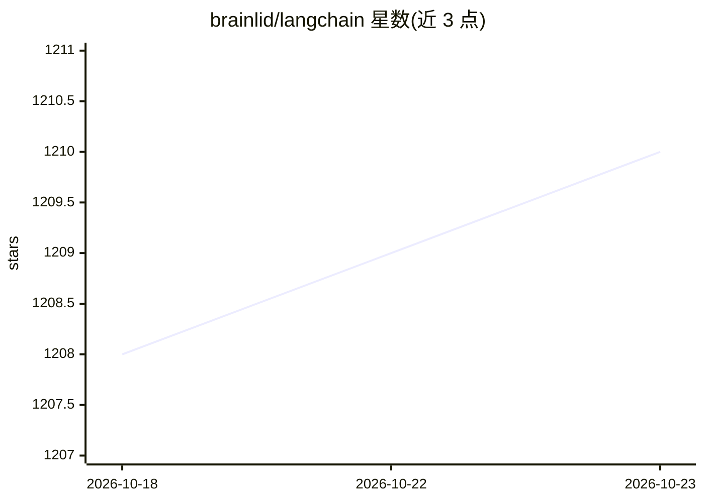

# brainlid/langchain

⭐ 1,210 · Elixir · NOASSERTION · 推送 2026-10-22 · [GitHub](https://github.com/brainlid/langchain) · [官网](https://hexdocs.pm/langchain/) · 个人维护

**Elixir 的 LangChain 式 LLM 应用开发框架，接入多家模型服务**

面向 Elixir 开发者的 LLM 应用框架：提供语言模型抽象组件与现成链（LLMChain 为核心模块），支持将应用内的自定义函数通过 LangChain.Function 暴露给 LLM 实现工具调用，并支持流式输出与消息结构。接入的聊天模型覆盖 Anthropic Claude（含扩展思考与 AWS Bedrock）、OpenAI（Chat Completions 与 Responses API）、xAI Grok、Gemini、DeepSeek、Ollama、Bumblebee 自托管模型，以及经 ChatOpenAICompatible 接入的 vLLM、Groq、OpenRouter 等 OpenAI 兼容服务。不追求与 JS/Python 版 LangChain 功能对等，要求 Elixir 1.17+，以 Hex 依赖方式安装。

## 筛选速览

| 维度 | 判定 | 备注 |
|---|---|---|
| AI 角色 | `ai-ecosystem` | LLM/agent 周边工具 |
| 许可风险 | `none` | NOASSERTION |
| 部署形态 | `None` |  |
| 模型依赖 | local-ok | 支持本地模型 |
| 硬件要求 | — | 无带数字的原话,不猜 |
| 安装摩擦 | `low` | 无编译、无系统依赖或容器化 |
| 成熟度 | — | 结构信号不足 |

## 能力要点

- LLMChain 核心模块组织模型调用、消息与链式组装
- LangChain.Function 将 Elixir 应用函数暴露给 LLM 做工具调用
- 支持 Anthropic、OpenAI、xAI、Gemini、DeepSeek、Ollama、Bumblebee 等多家模型
- ChatOpenAICompatible 通道接入 vLLM、Groq、OpenRouter 等 OpenAI 兼容服务

## 适用场景

- 在 Elixir 应用中集成 LLM 对话与工具调用
- 将本地 Bumblebee 或 Ollama 模型接入自有应用
- 通过统一抽象切换多家云端模型服务

## 场景标签

`Agent 框架` · 领域:Agent 开发

## 证据(README 行号)

> L7: Elixir LangChain enables Elixir applications to integrate AI services and self-hosted models into an application.
> L29: **LangChain** is a framework for developing applications powered by language models. It enables applications that a
> L36: 1. **Components:** abstractions for working with language models, along with a collection of implementations for ea

## 星数曲线

2026-10-18 1,208 → 2026-10-23 1,210（+2）

---
*卡片 v1 · prompt 1.4 · 生成 2026-10-21 · 置信度 high · 依据 README sha `04c0f7931059` · [字段定义](../../DATASET.md)*
