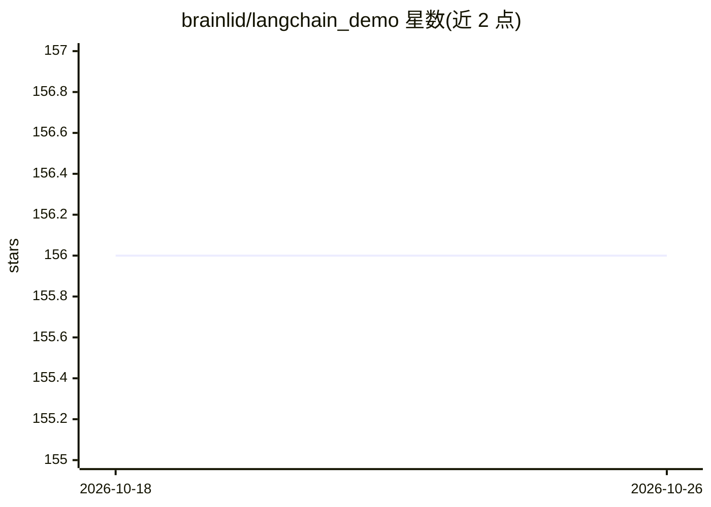

# brainlid/langchain_demo

⭐ 156 · Elixir · NOASSERTION · 推送 2026-04-04 · [GitHub](https://github.com/brainlid/langchain_demo) · 个人维护

**基于 Elixir LangChain 的 Phoenix 演示应用：对话与健身 Agent**

使用 Elixir LangChain 库与 Phoenix LiveView 构建的 Web 演示项目。提供两个功能页面：Conversations 页面通过 OpenAI API 进行 ChatGPT 对话，支持取消请求、编辑消息与重新提交，对话记录写入本地 SQLite；Personal Fitness Trainer 页面是一个 AI 健身助手 Agent，将用户数据与健身日志结构化存入本地数据库并可查询历史。通过 mix setup 安装依赖、设置 OPENAI_KEY 后以 mix phx.server 启动，浏览器访问 localhost:4400。

## 筛选速览

| 维度 | 判定 | 备注 |
|---|---|---|
| AI 角色 | `ai-native` | 本体是模型或模型工具 |
| 许可风险 | `none` | NOASSERTION |
| 部署形态 | `None` |  |
| 模型依赖 | — | README 未给出锁定关系 |
| 硬件要求 | — | 无带数字的原话,不猜 |
| 安装摩擦 | `low` | 无编译、无系统依赖或容器化 |
| 成熟度 | — | 结构信号不足 |

## 能力要点

- Conversations 页面支持取消请求、编辑与重新提交消息，记录存 SQLite
- Personal Fitness Trainer Agent 将用户数据结构化写入本地数据库
- 基于 Phoenix LiveView Async Operations 实现
- 附 YouTube 演示视频与配套博客文章

## 适用场景

- 学习 Elixir LangChain 库与 Phoenix LiveView 的集成方式
- 参考如何在 Elixir 应用中构建带持久化数据的 AI 助手
- 体验可编辑、可重提交的 ChatGPT 对话界面

## 场景标签

`聊天机器人` `AI 助手` · 领域:对话与助手

## 证据(README 行号)

> L3: This project is a demonstration example using the Elixir LangChain library and Phoenix LiveView.
> L15: Visit the Conversations page for having a conversation with ChatGPT.
> L33: Visit the Personal Fitness Trainer page to meet with your own Personal AI Fitness Trainer.

## 星数曲线

2026-10-18 156 → 2026-10-26 156（+0）

---
*卡片 v1 · prompt 1.4 · 生成 2026-10-22 · 置信度 high · 依据 README sha `3e9339aa40c9` · [字段定义](../../DATASET.md)*
