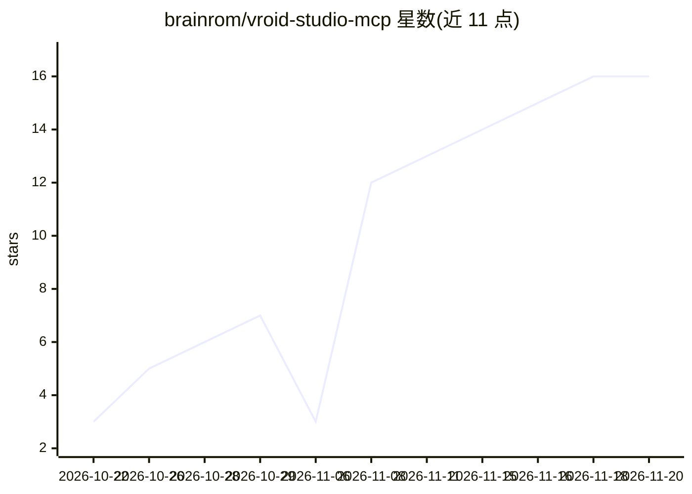

# brainrom/vroid-studio-mcp

⭐ 16 · C# · MIT · 推送 2026-11-07 · [GitHub](https://github.com/brainrom/vroid-studio-mcp) · 个人维护

**让 AI agent 直接操控 VRoid Studio 创建编辑 3D 角色的 MCP server**

以 BepInEx/IL2CPP 插件形式接入 VRoid Studio 2.14.0 的内部 API，在 http://127.0.0.1:17891/mcp 提供 MCP 端点，供 Claude Desktop、OpenCode 等 MCP 客户端的 agent 在真实编辑器中创建/编辑角色：选择分区、预设、调节滑杆与颜色、取景相机、查看渲染预览并保存 .vroid 文件。不模拟鼠标键盘、不读屏，窗口最小化时仍可工作；支持 Wine 下双向路径翻译。需单独安装 VRoid Studio 与 BepInEx 6，macOS 尚在研究中。

## 筛选速览

| 维度 | 判定 | 备注 |
|---|---|---|
| AI 角色 | `ai-ecosystem` | LLM/agent 周边工具 |
| 许可风险 | `permissive` | MIT |
| 部署形态 | `desktop` | 安装包/桌面程序 |
| 模型依赖 | — | README 未给出锁定关系 |
| 硬件要求 | — | 无带数字的原话,不猜 |
| 安装摩擦 | `low` | 无编译、无系统依赖或容器化 |
| 成熟度 | `idea` | |

## 能力要点

- 直接调用 VRoid Studio 内部 API，非鼠标/OCR 自动化，窗口最小化仍可运行
- agent 可获取渲染预览图与预设缩略图，按视觉判断结果
- 提供可读预设名与修正后的英文界面标签
- Wine (Linux) 下自动双向路径翻译

## 适用场景

- 用对话让 AI agent 在 VRoid Studio 里生成并保存 3D 角色
- 在脚本或 agent 工作流中批量程序化编辑 VRoid 角色
- Linux 用户经 Wine 运行并用本地 agent 操控编辑器

## 场景标签

`GUI 自动化` · 领域:效率与自动化

## 证据(README 行号)

> L7: `vroid-studio-mcp` is an adapter between **VRoid Studio 2.14.0** and AI agents. It lets an MCP client
> L61: 5. Start VRoid Studio. The plugin is now serving an MCP endpoint at
> L82: { "mcpServers": { "vroid-studio-mcp": { "url": "http://127.0.0.1:17891/mcp", "type": "http" } } }

## 星数曲线

2026-10-22 3 → 2026-11-20 16（+13）

---
*卡片 v1 · prompt 1.4 · 生成 2026-11-18 · 置信度 high · 依据 README sha `43e9133afa16` · [字段定义](../../DATASET.md)*
