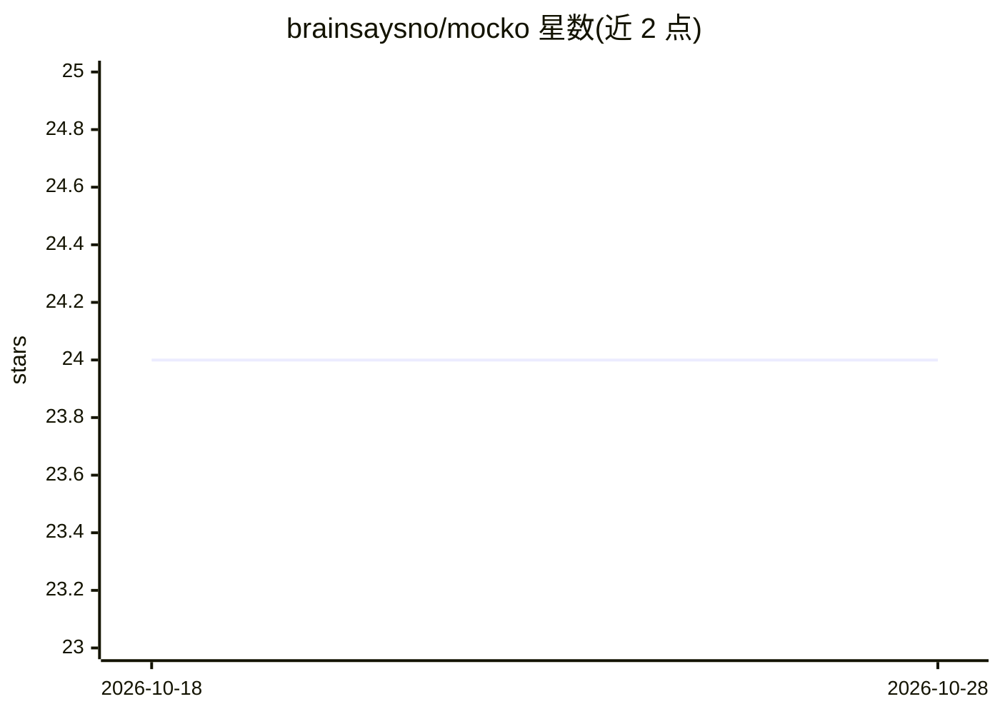

# brainsaysno/mocko

⭐ 24 · TypeScript · 推送 2026-01-27 · [GitHub](https://github.com/brainsaysno/mocko) · [官网](https://mocko.nrusso.dev) · 个人维护

**面向开发者的 mock 数据生成与一键表单填充工具**

Mocko 是一个 Web 应用加浏览器扩展（Chrome/Firefox）的组合：生成 JSON、文本或自定义结构的 mock 数据，支持 AI（多种 LLM）生成电子邮件、客户资料、工单等仿真数据，也提供固定数据集用于一致性测试。数据可预览、复制、通过邮件导出。浏览器扩展自动检测网页表单结构，快捷键唤起后按模板一键填充，模板与 Web 端双向同步，支持运行时变量占位符。技术栈为 TypeScript/React 前端与 Go/Gin 后端，本地构建需 pnpm 与 Nx，通过 git clone 源码安装。

## 筛选速览

| 维度 | 判定 | 备注 |
|---|---|---|
| AI 角色 | `ai-enhanced` | 去掉 AI 部分产品仍成立 |
| 许可风险 | `none` | — |
| 部署形态 | `library` | 以包/库形式分发 |
| 模型依赖 | — | README 未给出锁定关系 |
| 硬件要求 | — | 无带数字的原话,不猜 |
| 安装摩擦 | `low` | 无编译、无系统依赖或容器化 |
| 成熟度 | — | 结构信号不足 |

## 能力要点

- 支持 JSON、文本及自定义结构的 mock 数据生成
- 多种 LLM 生成电子邮件、客户资料、工单等仿真数据
- Chrome/Firefox 扩展自动检测表单并一键填充（Ctrl+Shift+M）
- 模板与 Web 端双向同步，支持 {{ 运行时变量 }}

## 适用场景

- 开发和测试时快速生成仿真数据
- 测试网页表单时一键填充，替代复制粘贴
- 用固定数据集做一致性测试场景

## 场景标签

`浏览器自动化` · 领域:效率与自动化

## 证据(README 行号)

> L48: **Mocko** is a powerful tool designed to simplify the development process by generating and exporting consistent, u
> L54: - AI-Powered Mock Data: Generate realistic data for emails, customer profiles, support tickets, and more using a wi

## 星数曲线

2026-10-18 24 → 2026-10-28 24（+0）

---
*卡片 v1 · prompt 1.4 · 生成 2026-10-27 · 置信度 mid · 依据 README sha `900c3b722404` · [字段定义](../../DATASET.md)*
